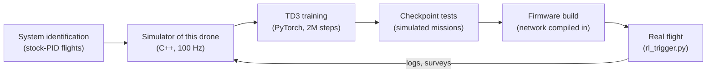
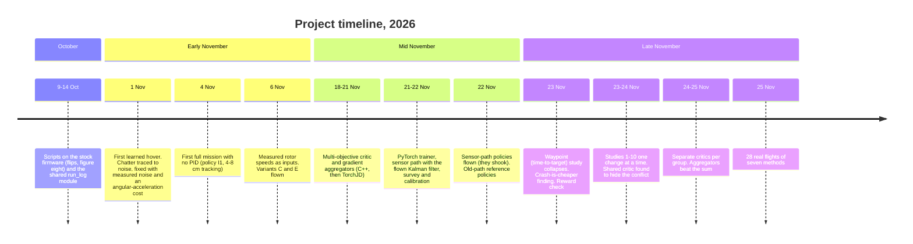

<!-- group: Start | reviewed: 2026-11-26 -->
# Overview

The project replaces the drone's flight controller with a neural network. Normally a Crazyflie
flies with a cascade of PID controllers: position to attitude to body rates to motor commands.
Here one small network maps what the drone knows about itself straight to the four motor speeds,
and it flies the whole mission: it takes off from the floor, hovers, flies a circle, comes back
and lands. Nothing else runs in the loop.

The network is trained with **TD3**, an off-policy actor-critic algorithm, in a simulator of this
exact drone, then compiled into the drone's firmware and run onboard at 100 Hz. The approach
follows *Learning to Fly in Seconds* (Eschmann, Albani and Loianno, RA-L 2024,
[arXiv 2311.13081](https://arxiv.org/abs/2311.13081)); most of the work here is about making it
work on the heavier, brushless Crazyflie 2.1 Brushless with its real sensors, and then about
**multi-objective training**: learning to trade precision, speed, smoothness and safety without
hand-tuning every reward weight.

## The approach in one picture

1. **Measure the drone** (mass, motor lag, thrust per rotor speed, sensor noise) and put the
   numbers in the simulator ([Simulator](04-simulator.md)).
2. **Train in simulation** with randomized physics, delays and noise, so the policy works on a
   drone that is never exactly the simulated one ([TD3](07-td3.md), [Reward](06-reward.md)).
3. **Test every late checkpoint** in simulated missions and pick one: TD3's quality swings
   between checkpoints, so the last one is never trusted blindly.
4. **Compile the chosen network into the firmware** and fly it, supervised by a script on the
   laptop ([Firmware and flights](11-flight.md)).
5. **Compare real flights with the simulator** and close the gaps (sensor noise, delays, motor
   behaviour), then train again.

## The drone

| Item | Value | Why it matters |
| --- | --- | --- |
| Platform | Crazyflie 2.1 Brushless (`cf21bl`), firmware 2026.08 | Brushless motors with ESCs; images built for the older `cf2` do not boot |
| Mass | 41.3 g with battery, Lighthouse deck and Flow deck | Heavier than the paper's Crazyflie 2.1; hover needs 15,470 rpm of 24,000 |
| Positioning | Lighthouse deck and two Lighthouse V2 base stations; Flow deck (optical flow and range) | The onboard Kalman filter fuses them; its estimate is what the policy sees |
| Motor feedback | Bidirectional DShot reports each motor's speed | The policy can **measure** its rotor speeds, which the paper's drone could not ([why it matters](05-policy-io.md#why-measured-rotor-speeds-replaced-the-action-history)) |
| Link | Crazyradio 2.0 | Flight script sends targets and receives logs |
| Compute | STM32F405 | One pass of the network takes about 0.7 ms, so it runs at 100 Hz, not 500 Hz |

## What made it work

Each of these was a problem first; the pages linked explain the cause and the fix.

1. **Measured sensor noise in training.** The first flown policy, trained with the paper's noise,
   made the motors chatter between almost 0% and 100%. The real gyro noise was about 35 times
   the paper's; training with it, plus a cost on angular acceleration, fixed the chatter
   ([Reward](06-reward.md#every-cost-term)).
2. **Mission training with a curriculum.** Take-off, landing, circles and lines are ramped into
   the episode mix over 800k steps; without the ramp, training never learned to fly
   ([Simulator](04-simulator.md#episodes)).
3. **Estimate-delay randomization.** The first policies collapsed with more than about 5 ms of
   delay between the drone's motion and its estimate; training with 0-12 ms (later 0-20 ms) of
   random delay removed most of the real jitter ([Simulator](04-simulator.md#delays-and-disturbances)).
4. **Measured rotor speeds as inputs** (variant E). With motor mismatch in training, 25 inputs
   with measured speeds flew as well as 149 inputs with a 32-step action history
   ([Policy I/O](05-policy-io.md)).
5. **A crash penalty instead of a survival bonus.** Equal in theory, clearly better in practice:
   fewer crashes and better tracking ([Reward](06-reward.md#crash-penalty-against-survival-bonus)).
6. **A reward check before every study.** With every reward a cost, crashing can pay; the check
   finds where in seconds ([Reward](06-reward.md#the-crash-incentive)).
7. **One critic per objective** for multi-objective training. A shared critic either destabilized
   the total value or merged the objectives into one; separate critics let the aggregators work
   ([Multi-objective TD3](09-moo.md#critic-designs)).

## Timeline

## Current status

| Area | State (2026-11-26) | Read |
| --- | --- | --- |
| Hover, circle, landing on the real drone | **Works.** Several policies within about 6-8 cm on a 0.6 m circle | [Flights](11-flight.md#flight-history) |
| Fast circles (0.63 m/s) | Works; errors 12-21 cm; the MOO picks beat TD3 | [Flights](11-flight.md#2026-11-25-seven-methods-28-flights) |
| Waypoint jumps (0.4-0.7 m) | Works for short jumps; slow settling (several seconds to 5 cm) | [Waypoints](10-waypoints.md) |
| Sensor path (policy sees the simulated Kalman estimate) | Trains as well as the old path; its policies shook in flight; calibration incomplete | [Sensor path](08-sensor-path.md) |
| Multi-objective training | Split critics: aggregators beat the sum, SVD-PGA matches TD3 in simulation; untuned test not run | [MOO](09-moo.md) |
| Statistics | Only the smoothness gain survives a correction for multiple comparisons | [Issues](13-issues.md#evidence-and-statistics) |

The [Issues](13-issues.md) page lists what is broken, unexplained or untested, and the
[Experiment log](12-experiments.md) has every study with its result.
