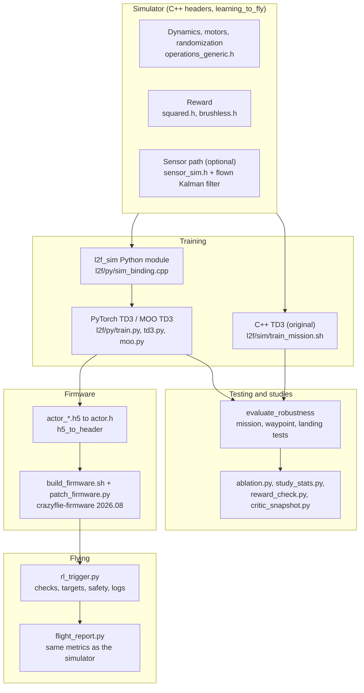
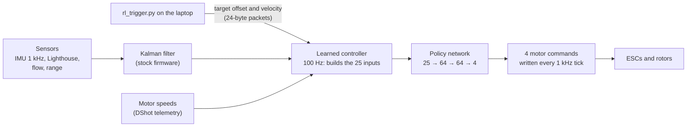

<!-- group: The system | reviewed: 2026-11-26 -->
# System architecture

How the pieces fit together: the hardware, the software, the path from a training run to a real
flight, and where everything lives in the repository.

## Hardware

| Part | What it does here |
| --- | --- |
| Crazyflie 2.1 Brushless (`cf21bl`) | The drone: STM32F405, four brushless motors with ESCs, 41.3 g with decks and battery |
| Lighthouse deck + 2 Lighthouse V2 base stations | Absolute position and attitude from laser sweeps; the base stations' geometry is stored per room (`config/IH222A`, `config/DroneLab`) |
| Flow deck v2 | Optical flow (velocity) and a time-of-flight range sensor (height); out of specification below about 4-8 cm |
| IMU (BMI088) | Gyro (clipped at ±2000 °/s = 34.9 rad/s) and accelerometer, 1 kHz |
| Bidirectional DShot | Each ESC reports its motor's speed; the policy reads these as inputs |
| Crazyradio 2.0 | Radio link to the laptop: target packets out, log data in |
| Laptops (macOS) | Flight interface (`rl_trigger.py`); Studies 1-10 ran 8-12 trainings at a time on a MacBook Pro (an 8 GB Mac takes about 4) |
| Lab computer (`ssh lab`, Linux, 14 cores) | Long training studies; no sudo |

## Software components

- **The simulator** is a modified copy of the *Learning to Fly in Seconds* simulator, header-only
  C++ ([`l2f/learning_to_fly`](../l2f/learning_to_fly/README.md)). Both trainers use the same
  headers, so a reward or physics change applies to both.
- **Two trainers.** The original C++ TD3 (RLtools, `train_mission.sh`) trained every policy up to
  2026-11-21. The **PyTorch trainer** (`l2f/py/train.py`) drives the same simulator through a
  pybind11 module and was checked to match the C++ statistics; it exists because the
  multi-objective work needs [TorchJD](https://github.com/TorchJD/torchjd)'s gradient aggregators.
  All current work uses it ([TD3](07-td3.md#pytorch-against-c)).
- **Two observation paths.** On the **old path** the actor sees the true state plus noise. On the
  **sensor path** (`-DL2F_SENSOR_SIM`) it sees the output of the drone's own Kalman filter, fed
  by simulated sensors ([Sensor path](08-sensor-path.md)). The MOO and reward studies use the old
  path.

## From a training run to a flight

```mermaid
flowchart LR
    T["train.py<br/>2M steps, seed s"] --> C["checkpoints<br/>actor_*.h5 every 100k"]
    C --> E["evaluate_robustness<br/>every late checkpoint"]
    E --> P["pick one<br/>(no crash, low jitter,<br/>best uneven-motor circle)"]
    P --> H["h5_to_header<br/>actor.h"]
    H --> B["build_firmware.sh<br/>HISTORY=0 RPM_OBS=1"]
    B --> Z["firmware zip"]
    Z --> F["flash_cold.py<br/>(cold boot only)"]
    F --> R["rl_trigger.py --mode mission"]
    R --> L["logs/rl_trigger_flight_*.csv"]
    L --> Q["flight_report.py"]
```

Chosen policies are kept in [`l2f/policies/`](../l2f/policies/README.md), one folder per flight
candidate with the checkpoint, the firmware header and the recipe. The steps and commands are on
[How-to](14-howto.md) and [Firmware and flights](11-flight.md).

## What runs on the drone

The controller replaces the stock PID stack only while `rl_trigger.py` has selected it; the drone
boots on PID. It computes the position and velocity error to the target sent by the laptop,
clips them (`rlt.pdlp`, `rlt.vdlp`), keeps the leaky position-error integral, reads the motor
speeds, evaluates the network and writes the motor commands. The full list of firmware changes is
on [Firmware and flights](11-flight.md#firmware-changes).

## Repository map

| Path | What |
| --- | --- |
| `rl_trigger.py` | Starts and supervises learned-controller flights: checks, Enter switch, missions, waypoints, safety landing, logs |
| `lighthouse_check.py`, `motor_check.py`, `sensor_check.py` | Pre-flight checks: Lighthouse reception and geometry, idle motor speeds, decks and estimator without flying |
| `noise_survey.py` | Sensor survey for the simulator (still, heights, hover, slide, logs modes) |
| `sysid_hover.py`, `sysid_analyze.py` | Stock-PID flights and the motor-model fit (lag, command-to-speed map, thrust constant) |
| `rpm_quality.py` | Checks the measured motor speeds in existing logs |
| `flash_cold.py` | Flashes a firmware zip with a cold boot |
| `flip.py`, `tricks.py`, `two_cf_lighthouse.py` | Demos on the stock firmware |
| `run_log.py` | Shared console and CSV logging; every script uses it |
| `config/` | Lighthouse geometry per room, `sensors.yaml` (sensor models), `landing.yaml` (landing values shared with training) |
| `l2f/learning_to_fly/` | The simulator, the C++ trainer, `evaluate_robustness`, `h5_to_header` |
| `l2f/py/` | PyTorch TD3 and MOO, the simulator module, `reward_check.py`, tests |
| `l2f/sim/` | Study tools: `ablation.py` and its `ablation_*.txt` study files, `study_stats.py`, `study_export.py`, `critic_snapshot.py`, `flight_report.py`, the C++ scripts |
| `l2f/estimator/` | The drone's Kalman filter compiled from the firmware as a library (sensor path) |
| `l2f/firmware/` | `build_firmware.sh`, `patch_firmware.py` |
| `l2f/policies/` | Flight candidates |
| `l2f/docs/` | The lab records (results, studies, flight days, CSV exports) |
| `reports/`, `research_notes/` | Literature review of the MOO contribution |
| `poster/` | Research poster source and figures |
| `documentation/` | These pages |

Local-only (git-ignored): `logs/` (every flight and gradient log), `cache/`, clones of the
Bitcraze repositories, study outputs (`l2f/learning_to_fly/ablation_*`, `compare_*`) and
checkpoints.

## Conventions that apply everywhere

- **Logging:** every script uses `run_log.py` (`log = run_log.setup(__file__)`; CSVs through
  `run_log.csv_path` and `run_log.write_csv`).
- **Commits:** `type[/scope]: summary` with types `feat`, `fix`, `refactor`, `chore`
  ([git skill](../.agents/skills/git/SKILL.md)). Commit only when asked.
- **Explanations give the math:** formula, symbols with units, what it does, the real values and
  the file they come from ([AGENTS.md](../AGENTS.md)).
- **New options are off by default** and leave older recipes bit-identical, checked by training.

> [!CAUTION]
> Flash this drone with a **cold boot only** (`flash_cold.py`), never a warm boot. Power-cycle it
> between learned flights: the emergency-stop watchdog stays latched until reboot.
