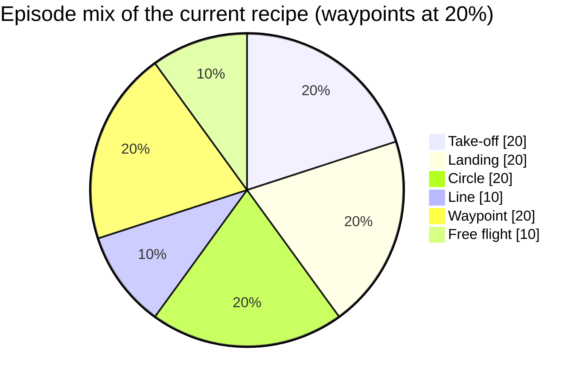

<!-- group: The system | reviewed: 2026-11-26 -->
# Simulator

The simulator is where the policy learns everything it knows, so every way it differs from the
real drone is a way the policy can fail in flight. This page explains what is modelled, with the
equations and the measured numbers, what is randomized and why, the training episodes and the
tests. It is a modified copy of the *Learning to Fly in Seconds* simulator (header-only C++ in
[`l2f/learning_to_fly/include/learning_to_fly/simulator/`](../l2f/learning_to_fly/README.md)).

## Rigid-body dynamics

The drone is a rigid body with four rotors in an X layout. With position $\mathbf{p}$, velocity
$\mathbf{v}$, attitude quaternion $q$ (rotation matrix $R$), body angular velocity
$\boldsymbol{\omega}$, mass $m$ and inertia $J$
([Newton-Euler equations](https://en.wikipedia.org/wiki/Newton%E2%80%93Euler_equations)):

$$
m\,\dot{\mathbf{v}} = R \sum_{i=1}^{4} f_i\,\hat{\mathbf{z}} + m\,\mathbf{g} + \mathbf{F}_{\text{ext}} - c_d\,\mathbf{v},
\qquad
J\,\dot{\boldsymbol{\omega}} = \sum_{i=1}^{4} \big(\mathbf{r}_i \times f_i \hat{\mathbf{z}} + \tau_i \hat{\mathbf{z}}\big) - \boldsymbol{\omega} \times J \boldsymbol{\omega}
$$

- $f_i = c_f\, \Omega_i^2$: thrust of rotor $i$ (N), $\Omega_i$ its speed (rpm).
- $\tau_i = \pm k_\tau f_i$: its drag torque about the body $z$ axis (sign alternates by spin direction).
- $\mathbf{r}_i$: rotor position, $(\pm 35.35, \pm 35.35, 0)$ mm.
- $\mathbf{F}_{\text{ext}}$: random external force; $c_d$: optional linear drag.
- $\boldsymbol{\omega} \times J\boldsymbol{\omega}$: gyroscopic term ([Euler's equations](https://en.wikipedia.org/wiki/Euler%27s_equations_(rigid_body_dynamics))).

The attitude evolves as $\dot q = \tfrac12\, q \otimes (0, \boldsymbol{\omega})$
([quaternion kinematics](https://en.wikipedia.org/wiki/Quaternions_and_spatial_rotation)). Each
10 ms step is integrated with fourth-order [Runge-Kutta](https://en.wikipedia.org/wiki/Runge%E2%80%93Kutta_methods).

| Parameter | Value | Source |
| --- | --- | --- |
| Mass $m$ | 0.0413 kg | scale |
| Inertia $J$ | diag(2.198e-5, 2.198e-5, 2.969e-5) kg m² | Busetto et al. ([arXiv 2512.14450](https://arxiv.org/abs/2512.14450)), scaled by mass |
| Arm | 35.35 mm | same |
| Thrust constant $c_f$ | 4.233e-10 N/rpm² (3.86e-8 N/(rad/s)²) | stock-PID system identification |
| Torque/thrust $k_\tau$ | 0.0021 m | Busetto et al. |
| Motor time constant $\tau_m$ | 0.06 s | system identification (0.055-0.065 s) |
| Command range | 0-24,000 rpm | model |

**Hover speed, worked out.** Four rotors must carry the weight: $4 c_f \Omega_h^2 = m g$, so
$\Omega_h = \sqrt{0.0413 \cdot 9.81 / (4 \cdot 4.233\times10^{-10})} = 15{,}469$ rpm, 64% of the
24,000 rpm range. Thrust grows with the square of speed, so full speed gives
$(24000/15469)^2 = 2.4$ times the weight: the drone can tilt about $\arccos(1/2.4) \approx 65°$
and still hold its height.

Source: [`parameters/dynamics/crazyflie_brushless.h`](../l2f/learning_to_fly/include/learning_to_fly/simulator/parameters/dynamics/crazyflie_brushless.h).

## Motors

The policy outputs $a_i \in [-1, 1]$, mapped linearly to a commanded speed
$\Omega_{\text{cmd},i} = \tfrac{a_i + 1}{2} \cdot 24000$ rpm. The rotor follows with a
[first-order lag](https://en.wikipedia.org/wiki/Time_constant):

$$
\dot\Omega_i = \frac{\Omega_{\text{cmd},i} - \Omega_i}{\tau_m}
\quad\Longrightarrow\quad
\Omega_i(t) = \Omega_{\text{cmd}} + (\Omega_0 - \Omega_{\text{cmd}})\, e^{-t/\tau_m}
$$

In one 10 ms step a motor covers only $1 - e^{-0.01/0.06} \approx 15\%$ of a commanded change.

> **Interactive:** in the viewer, step a motor command and watch the rotor speed and thrust follow for different time constants.

Measured motor effects that were added as options, each off by default:

| Effect | Model | Option | Why |
| --- | --- | --- | --- |
| Per-motor mismatch | motor $i$ settles at $g_i \Omega_{\text{cmd}} + o_i$, $g_i = 1 \pm 5\%$, $o_i = \pm 500$ rpm per episode | `L2F_MOTOR_GAIN`, `L2F_MOTOR_OFFSET` | `rpm_quality.py` measured 300-700 rpm between the model and each motor; used for every variant A-E |
| Common gain | one extra gain for all four, $\pm 10\%$ | `L2F_MOTOR_GAIN_ALL` | the firmware's voltage-compensated map was 18-23% off on a fresh battery (2026-11-22) |
| Gain wander | $g_t = \alpha g_{t-1} + \sigma\sqrt{1-\alpha^2}\,\varepsilon_t$, $\alpha = e^{-\Delta t/0.3\,\text{s}}$, $\sigma = 0.03$ | `L2F_GAIN_WALK` | battery sag during a flight ([AR(1) process](https://en.wikipedia.org/wiki/Autoregressive_model)) |
| Lag range | $\tau_m \sim U(0.045, 0.09)$ s | `L2F_MOTOR_TAU_MIN/MAX` | identified 0.045 s at 3.66 V and 0.057 s at 3.84 V; slower at low battery |
| ESC idle | an armed motor never turns slower than 2,500 rpm | `L2F_MOTOR_IDLE_RPM` | the ESC holds idle; the arming check expects 1,000-3,500 rpm |
| Dead time | the motors get the previous step's command | `L2F_ACT_DELAY_P` | measured 10 ms; **made training collapse** in the time-to-target study, not used since |
| Air drag | $-c_d \mathbf{v}$, $c_d \sim U(0, 0.03)$ N·s/m | `L2F_DRAG_MAX` | not identified; in the current recipe |

Study 1 of the reward studies found that drag, the lag range and gain wander cost no measurable
precision and make the policies slightly more robust, so they are part of the current recipe
([reward_studies.md section 3](../l2f/docs/reward_studies.md#3-study-1-sim-to-real-options)).

## Delays and disturbances

| What | Model | Default | Why |
| --- | --- | --- | --- |
| Estimate delay | the actor's observation is 0 to $N$ steps old, $N \sim U(0, \text{max})$ per episode | 0-12 ms; 0-20 ms in current runs (`L2F_DELAY_MAX_MS`) | the first flown policies collapsed above about 5 ms of delay, which explained most of their real jitter |
| Random external force | constant per episode, $\sigma = mg/20$ per axis | on (`L2F_FORCE_SCALE` = 1) | unmodelled pushes; on the sensor path the flown filter reads a steady sideways force as tilt |
| Position glitches | with probability $p$ per step the actor's position jumps 5-40 cm for up to 0.4 s, with a velocity spike | $p$ = 0.003 in training (`L2F_GLITCH_P`) | Lighthouse drop-outs caused 10-37 cm estimate jumps in flight; one flipped a policy trained without them |
| Gusts | episode type: a constant push of 1-4 m/s² for a while | off (`L2F_P_GUST`) | harder episode mix |
| Ground effect | thrust × $1/(1 - k (R/4h)^2)$, $R$ = 27.5 mm, $h$ = rotor height, $k \sim U(0, 2)$, cap 1.4 | on | not identified on this drone, so randomized |

> **Interactive:** in the viewer, the ground-effect thrust factor against height.

## Observation noise

With `-DL2F_REAL_NOISE` (every current recipe) the actor's inputs get Gaussian noise with the
standard deviations measured on this drone in PID hover and still tests: position 5 mm,
attitude 0.006 rad, velocity 0.010 m/s, **gyro 0.069 rad/s** (the paper used 0.002 rad/s, about
35 times less: the cause of the first flights' chatter). Measured rotor speeds get noise of
0.01 (about 120 rpm) and repeat their previous value with probability 0.15, as the real telemetry
does. On the sensor path the noise comes from the simulated sensors and the filter instead
([Sensor path](08-sensor-path.md)). Source: [`src/config/parameters.h`](../l2f/learning_to_fly/src/config/parameters.h).

## Domain randomization

With `L2F_DR=1` every episode draws its own physics. The paper's ranges are multiplied by
`L2F_DR_SCALE` (0.3 in training, 0.5 in the tests): full ranges prevent learning, 0.3 works.

| Quantity | Paper range | × 0.3 in training |
| --- | --- | --- |
| Mass | ±10% | ±3% |
| Inertia | ±20% | ±6% |
| Thrust constant | ±20% | ±6% |
| Torque constant | ±20% | ±6% |
| Motor time constant | ±20% (or the absolute range above) | ±6% |
| Centre of gravity | ±1 cm | ±3 mm |

All randomization ranges grow with the curriculum progress $k$ (0 to 1), so early training sees
the nominal drone.

## Episodes

Each episode lasts at most 5 s. Its type is drawn at the start; with progress $k < 1$ the draw is
$r = U(0,1)/k$, so the mission types grow from nothing to their full share as $k$ ramps from 0 to
1 over the first 800k steps, and free flight fills the rest.

| Task id | Type | Share at $k = 1$ | What happens |
| --- | --- | --- | --- |
| 0 | Free flight | the rest (30%; 10% with waypoints) | the original start: up to 0.2 m from the target per axis, tilted up to 90°, up to 1 m/s and 1 rad/s; 10% of them start exactly at the target |
| 1 | Take-off | 20% | resting on the floor, motors at 0-40% of hover; the target climbs 0.2-0.8 m at 0.15-0.8 m/s |
| 2 | Landing | 20% | hovering; the target descends at 0.1-0.5 m/s to slightly below the floor |
| 3 | Circle | 20% | radius 0.15-1.2 m, speed 0.1-1.0 m/s, either direction; half the starts already move with the target |
| 4 | Line | 10% | the target moves at 0.05-0.5 m/s in a random direction |
| 5-8 | Figure-eight, fast circle, point-to-point, gust | 0 (10% each with `--hard`) | harder mix |
| 9 | Waypoint | 0 (20% with `L2F_P_WAYPOINT=0.2`) | the target jumps, then moves again ([Waypoints](10-waypoints.md)) |

Free flight from random, tilted states is the hardest type and the one with the largest crash
incentive ([Reward](06-reward.md#the-crash-incentive)). Mission episodes have a floor
(take-off and landing touch it); free flight has none.

## Termination

An episode ends as a **crash** (reward $-P$) when:

- the position error exceeds 0.6 m on any axis (widened by twice the jump for waypoint episodes);
- the drone touches the floor tilted more than 60°;
- any axis rotates faster than 34.9 rad/s (`L2F_OMEGA_CRASH`, the gyro's range: beyond it the
  drone cannot measure its rotation);
- the speed exceeds `L2F_SPEED_CRASH` (waypoint studies only);
- the estimator fails (sensor path), or a landing cut happens too high.

It ends as a **landing** (no penalty, optional payout) when the motors are cut near the floor
(`L2F_LANDING_CUT`), and it is **cut off** without termination after 500 steps; the critic then
bootstraps from the last state.

## Tests

`evaluate_robustness <actor.h5> N <mode>` runs a checkpoint with deterministic actions:

| Mode | What it flies | Reports |
| --- | --- | --- |
| `mission` | The flight script's mission: on the floor → climb to 0.75 m → hover → circle of 0.6 m in 10 s → back → land at 0.25 m/s; clean, with uneven motors ("randomized"), and with 1% position jumps | per-phase tracking error, crashes, **jitter** (mean over motors of the standard deviation of the hover command; lower is smoother), landing |
| `waypoint` | Waypoint episodes only (jump sizes from the options); legs of 3.5 s with `L2F_EVAL_LEG_S=3.5` | crashes, arrival within 5 and 10 cm (below 0.2 m/s) and its time, overshoot, final error, peak speed |
| `landing` | The training landing episodes | landed / failed / crashed, cut height, touchdown speed |
| `probe` | 5 s from a perfect hover | noise response |

The test conditions are set with `L2F_EVAL_*` options (delay, randomization, glitches, noise).
Every study tests every arm under the same conditions, so training with an option is not mixed up
with testing under it. Results are medians over seeds and over the late checkpoints (1.2M-2.0M).

## Options reference

Runtime options are environment variables read when a simulator is created (`train.py --env
KEY=VALUE` passes them). Build options are `-D` flags of the CMake build. Every option is off by
default and leaves earlier recipes bit-identical.

| Option | Kind | Default | Effect |
| --- | --- | --- | --- |
| `L2F_BRUSHLESS` | build | – | the Crazyflie 2.1 Brushless model |
| `L2F_REAL_NOISE` | build | – | measured observation noise |
| `L2F_MISSION` | build | – | mission episodes, floor, curriculum |
| `L2F_RPM_OBS`, `L2F_HISTORY=n` | build | –, 32 | measured rotor speeds as inputs; action-history length ([Policy I/O](05-policy-io.md)) |
| `L2F_POS_INTEGRAL` | build | – | the leaky position-error integral as 3 inputs |
| `L2F_SENSOR_SIM` | build | – | the sensor path |
| `L2F_CRASH_PENALTY=P`, `L2F_SURVIVAL_BONUS=b` | build | 0, 2 | the reward's terminal terms; current runs 200 (override 400) and 0 |
| `L2F_ANG_ACC_WEIGHT`, `L2F_ACTION_RATE_WEIGHT`, `L2F_LANDING_SPEED_WEIGHT`, `L2F_ZIGZAG_WEIGHT` | build | – | reward weights (2e-4, 1, 5 in the recipe) |
| `L2F_CRASH_PENALTY_OVERRIDE` | runtime | – | crash penalty without a rebuild (400 in current runs) |
| `L2F_MISSION_RAMP` | runtime | 800000 (train.py) | curriculum length in steps |
| `L2F_DR`, `L2F_DR_SCALE` | runtime | 1, 1 (0.3 in training) | domain randomization and its scale |
| `L2F_DELAY_MAX_MS` | runtime | 12 | estimate delay range (20 in current runs) |
| `L2F_GLITCH_P` | runtime | 0 (0.003 in training) | Lighthouse-like position jumps |
| `L2F_MOTOR_GAIN`, `L2F_MOTOR_OFFSET`, `L2F_MOTOR_GAIN_ALL` | runtime | 0 | motor mismatch and common gain |
| `L2F_MOTOR_TAU_MIN/MAX`, `L2F_DR_MOTOR_TAU` | runtime | 0 | motor lag range |
| `L2F_MOTOR_IDLE_RPM`, `L2F_GAIN_WALK`, `L2F_DRAG_MAX`, `L2F_ACT_DELAY_P` | runtime | 0 | ESC idle, gain wander, drag, dead time |
| `L2F_GYRO_CLIP`, `L2F_OMEGA_CRASH` | runtime | 0 | gyro clip and rotation crash at 34.9 rad/s |
| `L2F_FORCE_SCALE` | runtime | 1 | strength of the random external force |
| `L2F_P_TAKEOFF`, `_LAND`, `_CIRCLE`, `_LINE`, `_EIGHT`, `_FAST_CIRCLE`, `_P2P`, `_GUST`, `_WAYPOINT` | runtime | 0.2, 0.2, 0.2, 0.1, 0, … | episode mix |
| `L2F_WAYPOINT_MIN/MAX`, `L2F_WAYPOINT_S_MIN/MAX` | runtime | 0.3/1.5, −1/0.5 | jump size and second-leg range |
| `L2F_POS_CAP`, `L2F_PROGRESS_K`, `L2F_W_TIME`, `L2F_W_POWER`, `L2F_W_SPEED`, `L2F_W_ENERGY` | runtime | 0 | reward shapes and terms of the waypoint work ([Reward](06-reward.md)) |
| `L2F_SPEED_CRASH`, `L2F_BRAKE_ACC`, `L2F_OBS_POS_CLIP`, `L2F_OBS_VEL_CLIP`, `L2F_WAYPOINT_RAMP` | runtime | 0 | waypoint-study options |
| `L2F_LANDING_CUT` | runtime | 0 | land like the flight script (`config/landing.yaml`) |
| `L2F_LH_PLACEMENT` | runtime | room | sensor path: base stations as in the room file, or random per episode |
| `L2F_EVAL_DELAY_MS`, `L2F_EVAL_DR`, `L2F_EVAL_KI`, `L2F_EVAL_LEG_S`, `L2F_MISSION_H/R/P` | test | – | test conditions |

The complete list with comments is in the `Mission` struct of
[`multirotor.h`](../l2f/learning_to_fly/include/learning_to_fly/simulator/multirotor.h) and the
header of [`l2f/sim/train_mission.sh`](../l2f/sim/train_mission.sh).

## Known gaps to the real drone

| Gap | Status |
| --- | --- |
| Drag, ground effect | not identified; randomized |
| Gyro noise is correlated in time on the drone | added on the sensor path (calibration 1); the old path's noise is white |
| A steady sideways force reads as tilt in the flown filter | real drones have much smaller steady forces; kept at full strength after a study |
| Real hover jitter is about 2.5 times the simulated one for most policies | open ([Issues](13-issues.md#sim-to-real)) |
| Telemetry and radio effects | not simulated; telemetry drops happened in flight |
