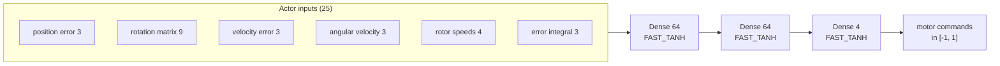

<!-- group: The system | reviewed: 2026-11-26 -->
# Policy inputs and outputs

What the actor sees, what it outputs, what the critic sees, and how the network is built. The
current policy is **variant E**: 25 inputs, no action history, measured rotor speeds.

## The actor's 25 inputs (variant E)

All positions and velocities are relative to the **target**: the policy never knows where it is
in the room, only how far it is from where it should be. Frames are the Lighthouse (world) frame;
the policy turns to yaw 0 of that frame.

| Index | Input | Units / scaling | On the drone |
| --- | --- | --- | --- |
| 0-2 | Position error $\mathbf{p} - \mathbf{p}_{\text{target}}$ | m | Kalman estimate minus the target from the laptop; clipped at ±`rlt.pdlp` (0.5 m; 2.0 for waypoint missions) |
| 3-11 | Attitude as a 3×3 [rotation matrix](https://en.wikipedia.org/wiki/Rotation_matrix), row by row | – | from the estimator's quaternion |
| 12-14 | Velocity error $\mathbf{v} - \mathbf{v}_{\text{target}}$ | m/s | estimate minus target velocity; clipped at ±`rlt.vdlp` (2 m/s) |
| 15-17 | Angular velocity (body) | rad/s | gyro, clipped at ±34.9 rad/s |
| 18-21 | Measured rotor speeds | $\Omega / 12000 - 1$ (so 0-24,000 rpm → −1 to 1) | DShot telemetry; the last valid value is kept on an invalid read |
| 22-24 | Leaky position-error integral | m·s | computed onboard the same way as in training |

Why a rotation matrix rather than a quaternion or angles: it is continuous (no wrap-around at
±180°, no sign ambiguity $q \equiv -q$), so nearby attitudes always give nearby inputs.

### The position-error integral

The three extra inputs are a leaky running sum of the position error,
$I_{t+1} = \lambda I_t + \Delta t\,(\mathbf{p}_t - \mathbf{p}_{\text{target}})$, clipped to a
maximum. It gives the policy a memory of persistent offsets (an uneven motor, a steady push) so it
can remove them itself, the job an integral term does in a PID controller. Diagnostics in the
waypoint test showed it helps: resetting it at each target jump made every policy worse
([reward_studies.md section 8](../l2f/docs/reward_studies.md#8-why-the-policies-settle-9-cm-off-after-a-jump)).

## The action

Four numbers $a_i \in [-1, 1]$, one per motor, mapped to commanded speeds
$\Omega_{\text{cmd},i} = \tfrac{a_i+1}{2} \cdot 24000$ rpm (hover is $a \approx 0.29$). The actor's
output layer is a squashing function, so the action is always in range. The rotors follow with
their lag ([Simulator](04-simulator.md#motors)). On the drone the firmware converts the commanded
speed to a motor command with the identified ESC map and writes it every 1 kHz tick.

## What the critic sees

The critic is trained only in simulation, so it gets the **true, noise-free** state and quantities
the drone cannot measure ([asymmetric actor-critic](02-rl-foundations.md#asymmetric-actor-critic)):

| Inputs | Count |
| --- | --- |
| Position error, rotation matrix, velocity error, angular velocity (all noise-free) | 3 + 9 + 3 + 3 |
| Random external force acting this episode | 3 |
| True rotor speeds | 4 |
| Position-error integral | 3 |
| **Total**, plus the 4 actions | **28 + 4** |

## Variants: action history or measured speeds

The paper's actor sees its last 32 actions, because its drone cannot measure rotor speeds: the
history lets it estimate what the lagging motors are doing. This drone can measure them, which
led to the variant study of 2026-11-06 (variant names from `train_mission.sh`):

| Variant | Inputs | Count | Notes |
| --- | --- | --- | --- |
| I1 | position, rotation, velocity, angular velocity, integral, 32 past actions | 149 | the first flown mission policy |
| A | as I1, trained with per-motor mismatch | 149 | |
| B | + measured speeds, 32 past actions | 153 | no better than A |
| C | + measured speeds, 4 past actions | 41 | |
| D | 4 past actions, no speeds | 37 | |
| **E** | **+ measured speeds, no action history** | **25** | **the current policy** |

### Why measured rotor speeds replaced the action history

With per-motor mismatch in training (each motor ±5% gain, ±500 rpm offset), the commands no longer
say how fast the motors actually turn; the measured speeds do. Simulation (3 seeds, medians over
checkpoints 1.2M-2.0M):

| Variant | Circle clean | Circle with uneven motors | Jitter | Crashed episodes |
| --- | --- | --- | --- | --- |
| A (32 history) | 7.1 cm | 12.0 cm | 0.063 | 5.1% |
| C (speeds + 4 history) | 7.2 cm | 9.6 cm | 0.067 | 1.8% |
| D (4 history, no speeds) | 9.0 cm | 10.2 cm | 0.086 | 1.7% |

Real flights on 2026-11-06 (four missions each, means of per-flight values):

| Policy | Inputs | Hover | Circle | Landing spot | Jitter hover / circle |
| --- | --- | --- | --- | --- | --- |
| I1 (32 history) | 149 | 4.0 cm | 7.4 cm | 2.8 cm | 0.057 / 0.061 |
| C (speeds + 4) | 41 | 4.5 cm | 7.1 cm | 5.4 cm | 0.071 / 0.078 |
| E (speeds only) | 25 | 5.2 cm | 7.0 cm | 4.3 cm | 0.056 / 0.050 |

With measured speeds the long history is not needed: circle tracking is the same with 25 inputs
as with 149. E did better in flight than in simulation, which suggests the training mismatch is
larger than the real one. Every policy since uses E (`HISTORY=0 RPM_OBS=1` in the firmware build).
Source: [results.md, "Measured motor speeds as input"](../l2f/docs/results.md#measured-motor-speeds-as-input).

> [!WARNING]
> The firmware build only checks the total input count. `HISTORY` and `RPM_OBS` must match the
> variant the checkpoint was trained with: 41 inputs also fit a 5-step history without speeds.

## The networks

| Network | Layers | Activation | Output |
| --- | --- | --- | --- |
| Actor | 25 → 64 → 64 → 4 | FAST_TANH on every layer, the output too | 4 actions in $[-1, 1]$ |
| Critic (one per twin) | (28 + 4) → 64 → 64 → $k$ | FAST_TANH hidden, linear output | $k = 1$ value (TD3), or one per reward group (MOO) |
| Split critic (MOO) | $k$ separate critics of (28 + 4) → 64 → 64 → 1 | same | one value per group, no shared layers ([MOO](09-moo.md#critic-designs)) |

FAST_TANH is RLtools' cheap rational approximation of $\tanh$, clipped at ±3; it is explained with
a widget on [TD3 as implemented](07-td3.md#networks-activation-and-optimizer). The actor has
$25 \cdot 64 + 64 + 64 \cdot 64 + 64 + 64 \cdot 4 + 4 = 6{,}084$ weights and biases; one pass takes
about 0.7 ms on the drone.

## Where this is in the code

| What | File |
| --- | --- |
| Observation types and their order | [`src/config/parameters.h`](../l2f/learning_to_fly/src/config/parameters.h) |
| Observation code (noise, clips, integral, delay) | [`operations_generic.h`](../l2f/learning_to_fly/include/learning_to_fly/simulator/operations_generic.h) |
| PyTorch networks | [`l2f/py/networks.py`](../l2f/py/networks.py) |
| Onboard input assembly | `l2f/learning_to_fly/controller/rl_tools_controller.c` (submodule) and the adapter written by [`build_firmware.sh`](../l2f/firmware/build_firmware.sh) |
