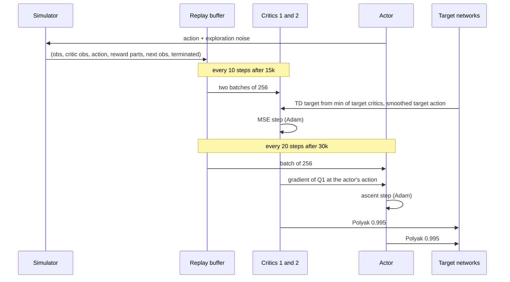

<!-- group: The system | reviewed: 2026-11-26 -->
# TD3 as implemented

This page is the exact training algorithm: every number, in the order the code runs it. The
PyTorch trainer ([`l2f/py/td3.py`](../l2f/py/td3.py), [`train.py`](../l2f/py/train.py)) mirrors
the C++ RLtools recipe line by line. For the ideas behind it, see
[RL foundations](02-rl-foundations.md#td3-three-fixes-to-ddpg).

## The loop

```text
for t = 0 .. 2,000,000:
    every 10k steps:   mission progress k = min(1, t / 800k)          (curriculum)
    every 100k steps:  position weight x1.2 (cap 40), velocity and action x1.4 (cap 1)   (not at t = 0)
    from 500k, every 100k:  exploration std, target-noise std and clip x0.9
    every 100k steps:  save the actor as actor_<t>.h5
    act:   a = clip(actor(o) + N(0, 0.1^2), -1, 1); one 10 ms simulator step
    store: (o, critic obs, a, reward parts, o', critic obs', terminated, task) in the buffer (700k)
    episode ends on termination or after 500 steps
    if t > 15k and t % 10 == 0:   train critic 1 and critic 2, each on its own batch of 256
    if t > 30k and t % 20 == 0:   train the actor on its own batch of 256
    after a critic update: Polyak 0.995 on both critic targets; after an actor update: on the actor target
```

| Setting | Value | Why |
| --- | --- | --- |
| Steps | 2,000,001 | the validated recipe; 3M runs exist but keep the 2M schedule ([Issues](13-issues.md#training-and-tools)) |
| Discount $\gamma$ | 0.99 | about 1 s horizon |
| Batch | 256 | |
| Replay buffer | 700,000 transitions | capped for memory |
| Warm-up | critics after 15k steps, actor after 30k | the buffer first fills with flights of the random initial actor |
| Update intervals | critics every 10 steps, actor every 20 | about one update per 10 environment steps; actor delayed (TD3 fix 2) |
| Exploration | Gaussian, std 0.1, ×0.9 every 100k from 500k | |
| Target smoothing | noise std 0.2, clip 0.5, both ×0.9 like exploration | TD3 fix 3 |
| Polyak | target ← 0.995 target + 0.005 trained | |
| Episode length | 500 steps (5 s) | |
| Checkpoints | every 100k steps | the late ones are all tested |

## The critic update

For a sampled batch of transitions $(s, a, \mathbf{u}, s', d)$, where $\mathbf{u}$ are the stored
unweighted reward parts and $d$ the termination flag:

$$
\begin{aligned}
r &= \mathbf{u}^\top \mathbf{w}_{\text{now}} \\
\tilde a' &= \operatorname{clip}\big(\mu_{\phi'}(s') + \operatorname{clip}(\epsilon, -c, c),\ -1,\ 1\big), \quad \epsilon \sim \mathcal{N}(0, \sigma_{\text{tgt}}^2) \\
y &= r + \gamma\,(1 - d)\, \min\big(Q_{\theta'_1}(s', \tilde a'),\ Q_{\theta'_2}(s', \tilde a')\big) \\
\mathcal{L}(\theta_i) &= \operatorname{mean}_{\text{batch}} \big(Q_{\theta_i}(s, a) - y\big)^2, \qquad i = 1, 2
\end{aligned}
$$

- $r$ is the reward computed with the **current** curriculum weights $\mathbf{w}_{\text{now}}$
  ([below](#reward-parts-in-the-replay-buffer)); $\sigma_{\text{tgt}}$ and $c$ are the target-noise
  std and clip (0.2 and 0.5, decaying).
- $d = 1$ only for **termination** (crash, landing). A transition cut off by the 500-step limit
  keeps $d = 0$ and bootstraps: the future after a time-out is real.
- Each critic gets its **own batch and its own target noise**, as RLtools does.
- The critics read the privileged, noise-free observation; the actors read the noisy one.

## The actor update

$$
\phi \leftarrow \phi + \alpha\, \nabla_\phi\, \operatorname{mean}_{\text{batch}}\, Q_{\theta_1}\big(s, \mu_\phi(s)\big)
$$

Only critic 1 gives the actor its gradient (as in TD3); critic 2 only enters the targets. In code
this is `(-value).backward()` followed by an optimizer step on the actor's weights.



## Reward parts in the replay buffer

The buffer stores the reward **split into its parts** $\mathbf{u}$ (unweighted, already scaled),
not the scalar reward. Each sampled batch gets rewards $r = \mathbf{u}^\top R$, where $R$ holds
the current weights. This matters because the weight curriculum changes the weights every 100k
steps: a transition stored at 300k (position weight 8.6) is learned from at 1.5M with weight 40,
exactly as RLtools recomputes every stored reward at each curriculum step. For multi-objective
training $R$ has one column per objective group, giving one reward per critic output
([MOO](09-moo.md#the-vector-critic)).

A subtle consequence found in Study 6: an all-zero extra reward column changed float32 rounding of
the matrix product and made runs differ; `train.py` now keeps only the columns in use, so new
options leave old recipes bit-identical.

## Networks, activation and optimizer

| Part | Setting |
| --- | --- |
| Actor | obs → 64 → 64 → 4, FAST_TANH on every layer (the output too) |
| Critic | (critic obs, action) → 64 → 64 → outputs, FAST_TANH hidden, linear output |
| Initialization | PyTorch's default `nn.Linear` (uniform, bound $1/\sqrt{\text{fan\_in}}$), the same as RLtools' "Kaiming" ([He et al.](https://arxiv.org/abs/1502.01852)) |
| Optimizer | Adam, learning rate $10^{-3}$, $\beta = (0.9, 0.999)$, $\epsilon = 10^{-8}$, decoupled weight decay on weights only |
| Observation normalization | none (as in the C++ training) |

**FAST_TANH** is RLtools' rational approximation of $\tanh$:

$$
y = \frac{x\,(27 + x^2)}{27 + 9x^2}, \quad x \text{ clipped to } [-3, 3]
$$

([Padé-type approximant](https://en.wikipedia.org/wiki/Pad%C3%A9_approximant); it is exactly ±1
at ±3.) RLtools back-propagates $1 - y^2$, the tanh rule, rather than the derivative of the
rational function; the PyTorch port copies that, because a different backward pass would change
training. Beyond ±3 the gradient is exactly zero: a saturated unit stops learning.

<div data-widget="fast-tanh">

> **Interactive:** in the viewer, FAST_TANH against tanh and the slope training uses.

</div>

**Weight decay.** RLtools decays weights after the Adam step, independent of the learning rate:
$p \leftarrow p - \alpha\,\text{adam}(g) - p\,\lambda/2$ with $\lambda = 10^{-4}$. PyTorch's
[AdamW](https://arxiv.org/abs/1711.05101) decays $p \leftarrow p\,(1 - \alpha\lambda')$, so the same
decay is $\lambda' = \lambda/(2\alpha)$ on the weight tensors and 0 on the biases
([`networks.py`](../l2f/py/networks.py)). Review: [Adam](https://arxiv.org/abs/1412.6980).

**Adam and gradient size.** Adam divides each weight's step by a running estimate of its gradient
size, so scaling a gradient up or down barely changes the step; only its **direction** matters
much. This is why gradient explosion was ruled out in the waypoint study (logged norms stayed
within about 2× while the weights grew) and why aggregators that only rescale change less than
their weights suggest ([MOO](09-moo.md#why-the-aggregators-did-not-help-on-the-shared-critic)).

## PyTorch against C++

The PyTorch trainer was accepted only after it matched the C++ one statistically (plan step A5).

- `test_td3.py` compares single updates with RLtools. It found that the port first used Adam
  $\epsilon = 10^{-7}$ (RLtools' TensorFlow preset) instead of the recipe's $10^{-8}$; $\epsilon$
  only matters for weights with tiny gradients but changed the first update by a third.
- Beyond about 1000 rounds two runs drift apart by themselves: once the actor leaves saturation,
  Adam turns rounding differences into full steps. A PyTorch copy fed the same batches in a
  shuffled row order drifts just as much. So only statistics of whole runs can be compared.

| Recipe | Trainer | Seeds | Circle | Uneven motors | Crashed | Jitter |
| --- | --- | --- | --- | --- | --- | --- |
| E | C++ | 6 | 6.5 cm | 13.6 cm | 4.0% | 0.069 |
| E | PyTorch | 6 | 6.0 cm | 13.1 cm | 3.5% | 0.069 |
| I1 | C++ | 6 | 7.9 cm | 11.8 cm | 2.8% | 0.055 |
| I1 | PyTorch | 6 | 9.0 cm | 12.2 cm | 6.3% | 0.058 |

E matches within the seed spread (Mann-Whitney p = 0.75 for circle error and crashes). I1 does not
differ significantly either, but PyTorch I1 had 4 collapsed late checkpoints in 3 of 6 seeds
against none in C++; with 6 seeds that can still be chance (Fisher p ≈ 0.18). PyTorch is cleared
for variant E, the recipe of all later work
([results.md, PyTorch training](../l2f/docs/results.md#pytorch-training-plan-step-3)).

Runs are deterministic for a given seed and machine. Builds on different machines round
differently (OpenBLAS on Linux, Accelerate on macOS), so compare runs from one machine only.

## Choosing a checkpoint

TD3's returns swing late in training, and one checkpoint can crash in tests while its neighbours
fly well. So every checkpoint from 1.0M or 1.2M to 2.0M is tested (100 episodes per condition),
results are reported as medians over seeds and checkpoints, and a flight candidate is picked by an
explicit rule. The rule of 2026-11-25: no crash in any test (1,200 mission episodes over two
worlds, two delays and clean / uneven-motor / glitch conditions, plus 100 waypoint episodes),
hover jitter at most 0.12, then the lowest circle error with uneven motors
([Flights](11-flight.md#2026-11-25-seven-methods-28-flights)).

## Cost of a run

One run uses one CPU core (64-unit networks gain nothing from threads). A 2M-step run takes
about 10-17 minutes on the MacBook with 8-12 runs in parallel, and about 5 minutes per run for the
C++ trainer on the old path; the sensor path is several times slower (14.6 µs against 2.6 µs per
simulator step).
