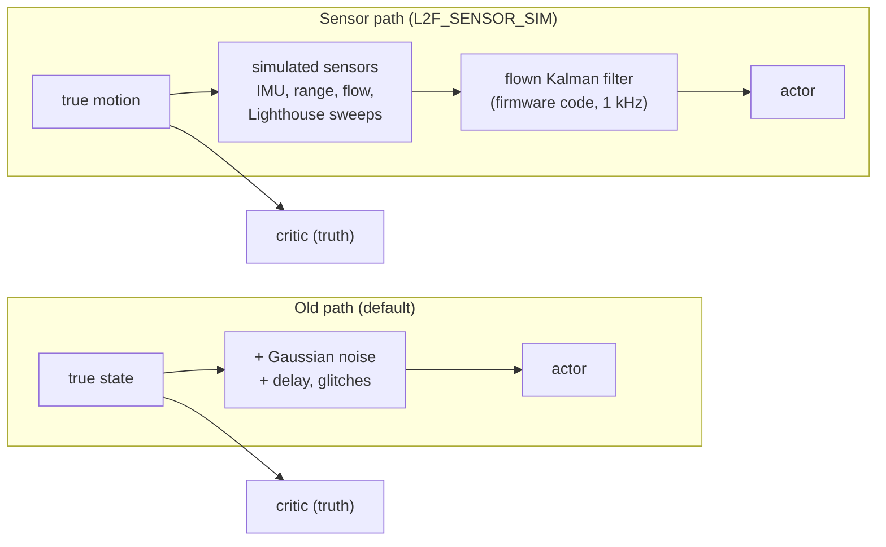

<!-- group: The system | reviewed: 2026-11-26 -->
# Sensor path

On the real drone the policy never sees the true state. It sees the onboard **Kalman filter's
estimate**, built from the IMU, Lighthouse sweeps, optical flow and the range sensor, with the
filter's own errors, lags and glitches. The sensor path (`-DL2F_SENSOR_SIM`) trains the policy on
exactly that: simulated sensors, fed into the drone's own filter code, compiled from the firmware.
The critic still sees the truth.

## Old path against sensor path

| | Old path | Sensor path |
| --- | --- | --- |
| Actor's position, attitude, velocity | truth + per-step Gaussian noise | the filter's estimate |
| Errors the policy learns to handle | white noise, delay, random jumps | the filter's real error structure: drift, lag, attitude error from forces, flow faults |
| Speed | 2.6 µs per step | 14.6 µs per step |
| Used by | all MOO and reward studies, the flown old-path policies | the sensor-path candidates of 2026-11-22 |

## What is simulated

From the header of [`sensor_sim.h`](../l2f/learning_to_fly/include/learning_to_fly/simulator/sensor_sim.h),
per 10 ms step (state 0 at the start, 1 at the end):

| Sensor | Model |
| --- | --- |
| IMU for the filter | one sample per step: gyro $(\boldsymbol\omega_0 + \boldsymbol\omega_1)/2 + \mathbf{b}_g + \mathbf{n}$; specific force $R_{\text{mid}}^\top\big((\mathbf{v}_1 - \mathbf{v}_0)/\Delta t + g\hat{\mathbf{z}}\big) + \mathbf{b}_a + \mathbf{n}$; gyro clipped at 34.9 rad/s |
| Gyro for the actor | $\boldsymbol\omega_1 + \mathbf{b}_g + \mathbf{n}$, clipped: the filtered sample the controller reads |
| Range (ToF) | every 25 ms: $(z + \text{gap}) / \cos(\max(0, \text{tilt} - \text{cone}))$ + bias + noise, in mm; different bias and noise below 4 cm |
| Optical flow | every ~10 ms: the inverse of the firmware's flow model with the true camera height, rounded counts; reduced gain below 8 cm or above 7.4 rad/s |
| Lighthouse | one sweep per base station at its own rate and phase, raw angles from the firmware's model with the true geometry (stored + error), angle noise, random drop-outs; at most 50 samples per second kept, as the firmware does |

Events inside a step use the interpolated state. The filter runs 10 ticks (1 kHz) per step and
predicts with the step's IMU average on the last tick. Parameters are ranges `[lo, hi]` in
[`config/sensors.yaml`](../config/sensors.yaml), drawn per episode.

The filter is the firmware's own code ([`l2f/estimator/`](../l2f/estimator/cf_estimator.h)):
`kalman_core.c`, the measurement models (`mm_tof.c`, `mm_flow.c`, `mm_sweep_angles.c`, ...), the
Lighthouse preprocessing, compiled unchanged from crazyflie-firmware 2026.08. Only the parts tied
to FreeRTOS tasks or global state are re-written line for line, so several simulated drones can
run side by side. Review: [Kalman filter](https://en.wikipedia.org/wiki/Kalman_filter),
[extended Kalman filter](https://en.wikipedia.org/wiki/Extended_Kalman_filter), and Bitcraze's
[state estimation notes](https://www.bitcraze.io/documentation/repository/crazyflie-firmware/master/functional-areas/sensor-to-control/state_estimators/).

## Checks

- With ideal sensors and no external force, the estimate stays within 1.6 mm (median position),
  0.10° (tilt) and 0.05° (yaw) of the truth in closed loop: frames, units and timing are right.
- The random external force (5% of the weight per axis) is read by the filter as tilt, because its
  flight model has thrust along body $z$ only: 2-3° median tilt error even with ideal sensors
  (0.2° without the force). A real drone has much smaller steady sideways forces.
- Starting the filter exactly at a level truth hits a firmware rounding edge: `kalmanCoreFinalize`
  can leave $R_{22} = 1 + 1$ ulp, and `acosf` of it in `mm_tof.c` is NaN. Episodes therefore start
  with the converged filter's typical errors; a firmware assert or non-finite state ends an
  episode as a crash (about 1 in 10,000). The same code on the drone would halt the estimator on
  the floor.
- A test bug: the sensor-path mission test first restarted the filter at the wrong state and moved
  the target without moving the room frame, so policies crashed 82-92% in the test while training
  normally. Fixed; no earlier result had used it.

## Calibration

`noise_survey.py` measures the sensors in modes `still`, `heights`, `hover`, `slide` and `logs`.
Only **sensor-level** values (gyro and accelerometer noise and correlation, range noise,
Lighthouse angle noise) go into `sensors.yaml`, with ranges widened about 20%; estimate-level
values (position noise, Lighthouse jumps) depend on the room and are left out.

- **Calibration 1** (2026-11-22, `still` and `hover`): per-axis gyro noise with AR(1) correlation
  (lag-1 correlation 0.54-0.66 on x, 0.24-0.35 on y, 0.23-0.39 on z), filter IMU noise in hover,
  range noise 1.3-1.8 mm, Lighthouse angle noise 4-12 times below the prior.
- **Calibration 2:** room-independent. A new random base-station layout every episode (1.5-3.5 m
  from the centre, 1.4-2.6 m high, 60-180° apart), so a policy is not tied to one room's geometry.
  A policy trained in the IH222A layout ended 45% of test episodes early in random layouts against
  20% in IH222A.
- Not yet run: `heights`, `slide`, `logs`. The range sensor below 4 cm, the flow model and the
  Lighthouse drop-outs keep their prior values.

> **Interactive:** in the viewer, white against correlated noise with the same spread.

## Findings

| Study | Result |
| --- | --- |
| Training on the sensor path (3 seeds, full force) | Trains as well as the old path: circle 5.8 cm, uneven motors 8.1 cm, **no crash in 810 test episodes** (old path 5.3 / 9.0 cm / 0.9%) |
| Weaker training force (0.5, 0.25) | No better; one seed of each collapsed. Full force kept |
| Jitter | About 50% higher on the sensor path (0.11-0.12 against 0.075): the estimator's noise reaches the actor |
| MOO on the sensor path (8 seeds, shared critic) | No method better than plain TD3 on circle error or crashes |
| First flight (TD3 candidate, 2026-11-22) | Held its position (spread 1.4-1.8 cm) but **shook**: motor commands jumped 20-50% of full range every 20 ms, 73% of the oscillation power at 15-25 Hz |

Two gaps explained the shaking: the real gyro noise is correlated in time (the simulator's was
white), and the policy chattered with more estimate delay than training covered (jitter 0.10 at
6 ms, 0.12 at 12 ms, 0.20-0.22 at 20 ms, the flight's level). Calibration 1 and training with
0-20 ms of delay followed; the calibration-2 candidate survives delay and unseen layouts far
better but its jitter stayed about the same. Since then the reward and MOO work has used the old
path; the sensor path is the tool for closing the sim-to-real gap later
([Issues](13-issues.md#sim-to-real)).

Records: [results.md, Sensor path](../l2f/docs/results.md#sensor-path-plan-step-2),
[policies](../l2f/policies/README.md).

## Flow deck limits (E4)

The flow sensor works from 8 cm and up to 7.4 rad/s; the range sensor is accurate from 4 cm. Two
options keep the deck inside its specifications: `rl_trigger.py --flow-off-below 0.1` switches the
flow off below 10 cm, and the `L2F_RANGE_MIN_PATCH` firmware patch with
`estimator.range_min_distance: 0.04` raises the range sensor's uncertainty below 4 cm, in the
simulator and the firmware alike. Both are off until the `heights` and `slide` surveys decide them.
