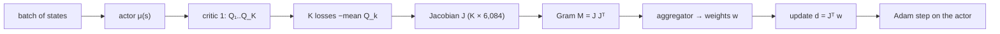
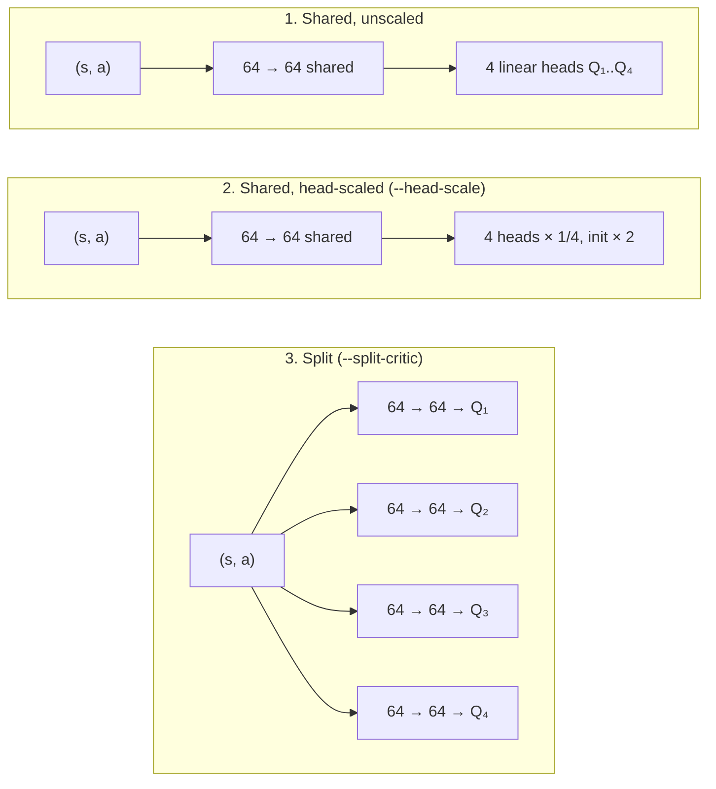

<!-- group: Research | reviewed: 2026-11-26 -->
# Multi-objective TD3

The reward is a weighted sum of costs, and its weights were tuned by hand: they decide how much
precision is worth against smoothness, speed and safety. Multi-objective (MOO) training keeps the
objectives apart, learns one value per objective, and combines their gradients with an
**aggregator** instead of a fixed sum. The research question: **can an aggregator find a good
trade-off on its own, and does it beat the hand-tuned sum?**

This page explains the method, the three critic designs, every aggregator, how conflict is
measured, and the results in the order they were found. The detailed record is
[`l2f/docs/moo_findings.md`](../l2f/docs/moo_findings.md).

## Objectives: reward groups

The simulator returns the reward split into parts ([Reward](06-reward.md#reward-parts-and-groups-for-moo)).
MOO groups them into objectives (`train.py --moo parts --parts K`):

| Setting | Objectives |
| --- | --- |
| `--parts 4` (current) | **time**; **precision** (position, velocity); **efficiency** (action, action rate, angular acceleration); **safety** (crash penalty, tilt, landing speed) |
| `--parts 3` | tracking; smoothness; safety (2026-11-22 studies) |
| `--parts 8` | each original part on its own (C++ era and first PyTorch round) |
| `--parts 0` | ungrouped: every weighted part on its own (11 objectives, time-to-target study) |
| `--parts 4 --grouping regroup` | crash; progress; effort; limits (time-to-target study) |
| `--parts 1` | everything in one objective: the MOO code path on the scalar reward; must equal TD3 (it does) |
| `--moo tasks` (framing B) | one objective per episode type: no conflict found (cosines +0.87 to +0.99), dropped |

Each group keeps the tuned weights of its parts, so the groups' natural sizes encode the tuned
priorities. The **untuned** test rescales them to equal shares (`--group-scale`).

## The vector critic

Each critic outputs one value per group, $Q_{\theta}(s,a) = (Q_1, \dots, Q_K)$, and each output
learns its own TD target:

$$
y_k = r_k + \gamma\,(1-d)\, Q'_{j^*,k}(s', \tilde a'), \qquad
j^* = \arg\min_{j \in \{1,2\}} \sum_k Q'_{j,k}(s', \tilde a')
$$

The twin with the smaller **summed** value supplies all $K$ targets, so the summed target equals
plain TD3's. The critic loss (`--total`) is

$$
\mathcal{L} = \operatorname{mean}\Big[\Big(\sum_k e_k\Big)^2 + \text{total} \cdot \sum_k e_k^2\Big], \qquad e_k = Q_k - y_k
$$

Without the first term (fitting each part on its own) the C++ trainer learned far slower; with it
(`--total 1`) the summed value stays as accurate as TD3's.

## The actor's gradients and the aggregator

The actor gets one loss per group, $L_k = -\operatorname{mean}_{\text{batch}} Q_{1,k}(s, \mu_\phi(s))$,
and one gradient per group, the rows of the [Jacobian](https://en.wikipedia.org/wiki/Jacobian_matrix_and_determinant)
$J = [g_1; \dots; g_K]$ (each $g_k$ has one entry per actor weight, 6,084 here). An aggregator
turns $J$ into one update, usually through weights computed from the
[Gram matrix](https://en.wikipedia.org/wiki/Gram_matrix) $M = J J^\top$ (all pairwise dot
products):

$$
d = J^\top \mathbf{w} = \sum_k w_k\, g_k, \qquad \mathbf{w} = \text{aggregator}(M)
$$

With **sum** ($\mathbf{w} = \mathbf{1}$), $d$ is the gradient of the summed value: exactly TD3's
update in expectation. Any other aggregator re-weights or re-directs it. The code is
[`l2f/py/moo.py`](../l2f/py/moo.py), using [TorchJD](https://github.com/TorchJD/torchjd)
(Quinton and Rey, [arXiv 2406.16232](https://arxiv.org/abs/2406.16232)) with all-ones preference
vectors.



## The aggregators

Notation: $g_i$ are the objective gradients (each points the way objective $i$ improves),
$C = \{x : g_j \cdot x \ge 0 \ \forall j\}$ is their **dual cone**
([dual cone](https://en.wikipedia.org/wiki/Dual_cone_and_polar_cone)): the updates that improve
every objective at once, to first order.

| Aggregator | Update | Idea | Review |
| --- | --- | --- | --- |
| Sum | $\sum_i g_i$ | linear scalarization: plain TD3 | – |
| Mean | $\tfrac1K \sum_i g_i$ | the same direction, smaller | – |
| PCGrad | each $g_i$ loses its component along any $g_j$ it conflicts with: $g_i \leftarrow g_i - \tfrac{g_i \cdot g_j}{\lVert g_j \rVert^2} g_j$ if $g_i \cdot g_j < 0$; then sum | remove the conflicting parts | [Yu et al. 2020](https://arxiv.org/abs/2001.06782), [vector projection](https://en.wikipedia.org/wiki/Vector_projection) |
| MGDA | the shortest vector in the convex hull of the $g_i$ | the common descent direction | [Sener and Koltun 2018](https://arxiv.org/abs/1810.04650) |
| UPGrad | $\sum_i \Pi_C(g_i)$ | project every gradient onto the dual cone, then add | [TorchJD paper](https://arxiv.org/abs/2406.16232), [quadratic programming](https://en.wikipedia.org/wiki/Quadratic_programming) |
| DualProj | $\Pi_C\big(\sum_i g_i\big)$ | the smallest change to the sum that hurts no objective | same |
| Aligned-MTL | $\mathbf{w} = \sqrt{\lambda_{\min}}\, V \Lambda^{-1/2} V^\top \mathbf{1}$ from $M = V\Lambda V^\top$ | make the gradients' principal components equally strong | [Senushkin et al. 2023](https://arxiv.org/abs/2305.19000), [eigendecomposition](https://en.wikipedia.org/wiki/Eigendecomposition_of_a_matrix) |
| SVD-PGA | $\mathbf{w} = \tfrac1t \sum_{j} o_j\, v_j / \sqrt{\lambda_j}$, $o_j = \pm1$ orients $v_j$ toward the gradients | average the gradients' principal directions with equal weight (a [whitening](https://en.wikipedia.org/wiki/Whitening_transformation)); step length $1/\sqrt{t}$ always | [SVD](https://en.wikipedia.org/wiki/Singular_value_decomposition) |
| OS-NMF-PGA | approximate $J^\top \approx W H$ with orthonormal $W$ and non-negative $H$, average the columns of $W$ | principal directions constrained to point "with" the gradients | [NMF](https://en.wikipedia.org/wiki/Non-negative_matrix_factorization) |

The PGA aggregators come from R. Khosrowshahi's TorchJD fork (branch `feat/pga-aggregators`).

<div data-widget="aggregator-playground" data-preset="opposed">

> **Interactive:** in the viewer, drag two or three gradients and see every aggregator's update, which objectives it improves, and its weights. The widget's math is checked against TorchJD by `documentation/tools/check_widgets.py`.

</div>

Things to try in the playground:

- **Big against small, opposed** (the default): the crash gradient is large, smoothing small and
  almost opposite. PCGrad and UPGrad add a large multiple of the small gradient (projecting the
  big one off the small one adds about $\lVert g_{\text{big}}\rVert \cos / \lVert g_{\text{small}} \rVert$
  small gradients). This is how UPGrad raised the smoothing weight to 7-18 times and made policies
  too careful to fly in the first rounds.
- **Aligned:** every method agrees; the balancing ones (Aligned-MTL, SVD-PGA) still change the
  length and tilt the direction toward the smaller gradient.
- **Directions only:** Adam mostly cares about direction, so compare the arrows' angles.

## Measuring conflict

| Measure | Formula | Meaning |
| --- | --- | --- |
| Pairwise cosine | $\cos(g_a, g_b) = \dfrac{g_a \cdot g_b}{\lVert g_a \rVert \lVert g_b \rVert}$ | below 0: the two objectives want opposite changes ([cosine similarity](https://en.wikipedia.org/wiki/Cosine_similarity)) |
| Share of updates opposed | fraction of logged updates with $\cos < 0$ | how often a pair conflicts |
| Sum hurts a group | fraction with $g_k \cdot \sum_j g_j < 0$ | the plain sum would make group $k$ worse; only then can DualProj change anything |
| Cancellation | $\lVert \sum_k g_k \rVert / \sum_k \lVert g_k \rVert$ | 1: all agree; near 0: they cancel |
| Norms | $\lVert g_k \rVert$ | which objective dominates the sum |

Every 50 actor updates the trainer logs norms, cosines, aggregator weights and a check
$\lVert J^\top \mathbf{w} - d \rVert / \lVert d \rVert$ (must be about $10^{-7}$) to
`logs/train_moo_*.csv`; `l2f/py/moo_report.py` summarizes them. **A conflict measurement is only as
good as the critic it comes from**: `l2f/sim/critic_snapshot.py` measures the critic itself (the
correlation between its group values, the share of their variance along one direction, and each
group's fit $R^2$ to its own TD target). That tool found the problem of the next section.

## Critic designs

All three designs train the same groups with the same targets; they differ in what is shared.



### Shared and unscaled: the total moves too fast

With heads $Q_k = v_k^\top h(s,a) + b_k$ on a shared body $h$, the total-error term gives every head
the same correction. Adam moves each head's weights about one learning rate per step regardless of
the gradient's size, so the **total moves about $K$ times as far** per update as TD3's single
head, and four random heads start with about $\sqrt{4} = 2$ times the spread. Measured on 20 fresh
critics:

| Critic | Starting spread of the total | Distance the total moves per update |
| --- | --- | --- |
| TD3, 1 head | 0.137 | 0.0285 |
| MOO, 4 heads | 0.281 (2.1×) | 0.0646 (2.3×) |
| MOO, 4 heads, head-scaled | 0.137 | 0.0266 |

Effectively a critic learning rate more than twice TD3's, on the value the actor follows: MOO sum
trailed TD3 (8 seeds: 6.8 against 6.0 cm, 2.9 against 1.4% crashes). The group values themselves
were distinct and well fitted ($R^2$ 0.90-1.00).

### Shared and head-scaled: the groups collapse

`--head-scale` multiplies the outputs by $1/K$ and the initial output weights by $\sqrt K$, so the
total starts and moves exactly like TD3's. But it changes the balance between the two kinds of
weights. Adam still moves a head's own weights $v_k$ about one learning rate per step, and the
$1/K$ factor shrinks the effect on $Q_k$: **each group's own output learns $K$ times slower**. The
shared body moves all outputs at once at full speed. So the loss falls fastest through the shared
body, which fits the total (dominated by the large crash and safety terms), and the four outputs
become scaled copies of one value:

| Critic | Step | Correlation between group values | Share of variance along one direction | Fit $R^2$ time / precision / efficiency / safety |
| --- | --- | --- | --- | --- |
| shared, unscaled | 1.2M | +0.67 to +0.98 | 0.893 | 1.00 / 1.00 / 0.98 / 1.00 |
| shared, head-scaled | 200k | **+0.99 to +1.00** | 0.996 | 0.80 / 0.80 / 0.81 / 0.73 |
| shared, head-scaled, untuned reward | 1.2M | **+1.00** | **1.000** | 0.92 / 0.88 / 0.65 / **0.49** |
| **split** | 1.2M | **+0.29 to +0.68** | **0.859** | **0.98 / 1.00 / 0.98 / 0.99** |

The groups' own per-step rewards are nearly uncorrelated (−0.39 to +0.16), so the values have no
reason to be copies. With copies, every $g_k$ points the same way, the aggregators see no conflict
and reduce to the sum. Every head-scaled result (Studies 7-8) is therefore uninformative about
aggregation.

### Split: one network per group

`--split-critic` gives each group its own 64-64 network, no shared layers; two twins, so 8 critic
networks plus targets, against TD3's 2. A group's features serve only its own value: nothing can
merge the groups, and no large group crowds out a small one. Distinct, well-fitted values, and the
**real conflict** shows up (share of updates opposed, last 0.6M steps, MOO sum):

| Pair | Shared, head-scaled | Shared, unscaled | **Split** |
| --- | --- | --- | --- |
| precision-efficiency | 2% | 47% | **82%** (mean cosine −0.41) |
| precision-safety | 16% | 46% | **76%** (−0.30) |
| time-precision | 1% | 38% | **68%** (−0.19) |
| time-safety | 10% | 2% | **57%** (−0.08) |
| efficiency-safety | 41% | 17% | 43% (+0.08) |
| time-efficiency | 15% | 6% | 39% (+0.12) |

Holding the exact target costs effort and smoothness (precision-efficiency), and fights speed and
caution. This is the first setup in which the aggregators have real conflict to resolve.

A shared body might still work with a different design (per-head target normalization in the
style of [PopArt](https://arxiv.org/abs/1602.07714), a small private layer per head); neither was
tested.

## Results

### On the shared critic: no aggregator beats the sum

| Round | Setup | Outcome |
| --- | --- | --- |
| C++, 8 parts, with survival bonus (2026-11-18) | sum, Aligned-MTL, OS-NMF-PGA, SVD-PGA, UPGrad | none beats sum; UPGrad 66% crashes (it raised the action-rate weight 7-18×) |
| PyTorch, no bonus, 8 parts and 3 groups (2026-11-22) | 7 aggregators, 2 seeds | none beats sum; DualProj on 3 groups ties it; PCGrad and UPGrad on 8 parts collapse |
| Sensor path, 3 groups, 8 seeds | TD3, sum, DualProj | no method better; DualProj behind TD3 with uneven motors |
| Time-to-target (2026-11-23) | 4 groups, ungrouped, regrouped | every arm crashed: the reward paid for crashing ([Waypoints](10-waypoints.md)) |
| Study 5 (time 0.5 recipe, 4 groups, 4 seeds) | 6 aggregators | no MOO arm beats TD3; UPGrad 50.6% crashes; balancing aggregators 13-14% |
| Study 6 (8 seeds) | DualProj, critic loss, delayed start | DualProj's 4-seed lead was noise; UPGrad started at 1.2M does not collapse but adds nothing |
| Study 7 | head scaling | MOO sum level with TD3, but the groups collapse (found in Study 9) |
| Study 8 (untuned, equal shares) | TD3 and 6 aggregators | untuned TD3 far behind tuned; aggregators no help; gradients parallel because of the collapse |

### Why the aggregators did not help on the shared critic

1. **The groups' scales encode priorities.** The tuned weights make safety's gradient about 10
   times time's. Aligned-MTL, SVD-PGA and OS-NMF-PGA equalize the groups: they gave time 16-36
   times its weight and **negative weights** to precision and safety, pushing the policy against
   crash avoidance (13-14% crashes). They are designed for objectives whose scales are arbitrary.
2. **Most early conflict is the healthy one of learning not to crash.** In the first 0.8M steps
   the crash term opposes the small costs in 63-80% of updates, and it should win. UPGrad kept
   boosting the small groups (efficiency up to 6.3 times) and two of four seeds collapsed;
   started at 1.2M it did not.
3. **A trade-off is not interference.** Aggregators help when shared parameters make one
   objective's update damage another although a better update for both exists. Late in training
   the conflict is a real trade-off (precise hovering costs effort); an aggregator can only move
   the result to another point on it.
4. **The MOO base was weaker than TD3** (the 2.3× critic step), so even a neutral aggregator could
   not win.
5. **Adam reduces what reweighting can do:** rescaling barely matters, only redirection does.

Mechanisms 1-3 still describe the aggregators correctly; the premise that the task had little
conflict was the critic's fault (Study 9).

### On split critics: the aggregators beat the sum

`ablation_split_agg.txt` and `_confirm.txt`, 8 seeds per arm, time 0.5 recipe with E's tuned
weights; mission test 12 ms; waypoints 3.5 s legs:

| Arm | Circle | Uneven motors | Crashed | Crash-free checkpoints | Jitter | 10 cm arrival 0.5 / 0.8 m (time) |
| --- | --- | --- | --- | --- | --- | --- |
| **td3 (variant E)** | 6.0 cm | **9.7 cm** | **1.4%** | **18/72** | 0.121 | 79.5 / 69.0% (1.73 s) |
| sum | 5.0 cm | 11.2 cm | 4.5% | 7/72 | **0.065** | 78.0 / 71.5% (1.55 s) |
| DualProj | 5.3 cm | 11.3 cm | 3.9% | 9/72 | 0.066 | 77.0 / 68.0% (1.60 s) |
| UPGrad | 5.0 cm | 10.1 cm | 2.7% | 7/72 | 0.069 | **84.0 / 76.5%** (1.54 s) |
| Aligned-MTL | 5.0 cm | 10.4 cm | 2.4% | 17/72 | 0.079 | 82.5 / 76.0% (**1.48 s**) |
| **SVD-PGA** | 4.9 cm | 10.4 cm | 1.7% | 14/72 | 0.106 | 83.5 / 76.0% (1.53 s) |
| OS-NMF-PGA | **4.5 cm** | 10.2 cm | 2.5% | 16/72 | 0.081 | 79.5 / 73.0% (**1.48 s**) |

- Every reweighting aggregator crashes less than the sum on the same critic and reward (1.7-2.7%
  against 4.5%) and handles uneven motors better. DualProj, whose weights stay at 1, does not.
- SVD-PGA against variant E: better circle (4.9 against 6.0 cm) and waypoints, level on crashes
  and uneven motors (within seed spread), rougher than the sum.
- **How SVD-PGA gets there:** it gives efficiency (smoothing) only about 6% of the step, against
  24% for the sum, and about a quarter each to time, precision and safety. That trade-off was not
  tuned by hand.

| Aggregator | Median weights time / precision / efficiency / safety | Share of the step |
| --- | --- | --- |
| DualProj | 1 / 1 / 1 / 1 | 0.16 / 0.36 / 0.24 / 0.21 |
| UPGrad | 1.46 / 1.84 / 1.22 / 3.75 | 0.17 / 0.32 / 0.22 / 0.29 |
| Aligned-MTL | 0.55 / 0.38 / 0.16 / 0.95 | 0.27 / 0.28 / 0.15 / 0.30 |
| SVD-PGA | 0.36 / 0.21 / 0.03 / 0.46 | 0.28 / 0.24 / 0.06 / 0.26 |
| OS-NMF-PGA | 0.37 / 0.22 / 0.06 / 0.52 | 0.28 / 0.29 / 0.10 / 0.28 |

Per-seed crash rates (plain world, 12 ms, seeds 70-77), from
[`l2f/docs/results/split_agg/per_seed_8seeds.csv`](../l2f/docs/results/split_agg/per_seed_8seeds.csv):

<div data-widget="seed-compare" data-metric="crashed episodes (%)" data-a="td3" data-b="SVD-PGA" data-arms="td3:0.5,0.6,1.9,0.3,4.1,1.2,0.8,2.3;sum:2.0,3.1,4.9,3.0,1.6,9.7,9.7,1.9;DualProj:2.2,12.6,2.6,2.2,3.1,3.9,1.2,3.5;UPGrad:4.1,2.5,3.6,4.8,1.6,1.8,2.1,1.1;Aligned-MTL:5.7,1.9,1.7,1.3,2.1,2.1,2.4,2.4;SVD-PGA:1.2,3.4,1.0,1.2,1.3,1.4,2.0,1.9;OS-NMF-PGA:1.4,3.8,2.8,1.9,1.7,2.7,2.8,2.7">

> **Interactive:** in the viewer, compare any two arms seed by seed with a bootstrap interval and an exact Mann-Whitney test.

</div>

And the per-seed hover jitter, the one difference that survives a correction for 48 comparisons:

<div data-widget="seed-compare" data-metric="hover jitter" data-a="td3" data-b="sum" data-arms="td3:0.108,0.127,0.130,0.127,0.117,0.119,0.118,0.114;sum:0.070,0.072,0.059,0.060,0.082,0.052,0.068,0.054;DualProj:0.069,0.070,0.058,0.062,0.071,0.063,0.071,0.056;UPGrad:0.065,0.069,0.061,0.080,0.061,0.079,0.071,0.065;Aligned-MTL:0.064,0.080,0.076,0.072,0.097,0.084,0.086,0.073;SVD-PGA:0.095,0.107,0.113,0.091,0.147,0.094,0.108,0.113;OS-NMF-PGA:0.077,0.077,0.068,0.117,0.094,0.102,0.074,0.100">

> **Interactive:** in the viewer, the same comparison for hover jitter.

</div>

What the statistics support ([`study_stats.py`](../l2f/sim/study_stats.py), Holm correction over
48 comparisons per baseline; [next_steps.md](../l2f/docs/next_steps.md)):

- **Holds after correction:** sum, DualProj, UPGrad and Aligned-MTL have smoother motor commands
  than variant E (jitter 0.066-0.078 against 0.118).
- **p < 0.05 before correction only:** every MOO arm reaches waypoints 0.15-0.37 s sooner;
  SVD-PGA crashes less than sum (p = 0.018); sum crashes more than variant E.
- **No clear difference:** circle error of any arm against variant E (the 95% interval is about
  ±2 cm with 8 seeds); SVD-PGA's crash rate against variant E (p = 0.34).

### In flight

On 2026-11-25 one checkpoint per method flew the same missions (28 flights). Every aggregator
except Aligned-MTL beat variant E on the circle and the fast circle; OS-NMF-PGA was the calmest
and most precise at low speed, SVD-PGA the most accurate at speed and on big jumps; the sum
rocked hardest (tilt RMS 18-21°); Aligned-MTL rocked ±40° and crashed. Details:
[Firmware and flights](11-flight.md#2026-11-25-seven-methods-28-flights).

## What is not shown yet

- **That aggregation replaces tuning.** Every group still holds E's tuned weights. The fair test,
  the untuned reward on split critics against tuned variant E, has not been run.
- **That it is more than a reweighting.** TD3 with its smoothing weight reduced to SVD-PGA's
  effective share might match it; one TD3 arm would tell.
- **Critic size.** Split critics have 4 times TD3's critic parameters.
- **Why the sum crashes more on split critics than TD3** (4.5 against 1.4%): possibly failure 1
  above (the total moving faster), not measured on the split critic.
- **Significance** beyond jitter, which needs 12-16 seeds for 1-2 cm claims.

The literature review in [`reports/`](../reports/MOO%20quadrotor%20RL%20novelty%20review.md)
judges the shared-critic diagnosis (step size and head collapse) and the controlled
shared-against-separate conflict measurement as the most novel parts, and recommends presenting
the aggregator result as "matching hand-tuned performance without a weight search", with
controls (per-head normalization, matched learning rates, a tuned linear-scalarization sweep).

## Running it

```bash
B=l2f/learning_to_fly/build_py_E_nb200/src
python3 l2f/py/train.py --build $B --variant E --seed 70 \
  --moo parts --parts 4 --total 1 --split-critic --agg svd_pga \
  --env L2F_OMEGA_CRASH=34.9 --env L2F_CRASH_PENALTY_OVERRIDE=400 ...
python3 l2f/py/moo_report.py logs/train_moo_*.csv        # conflict summary
python3 l2f/sim/critic_snapshot.py --out snap.json --at 200000 1200000 -- --seed 70 --moo parts ...
```

The full recipe is in the study files (`l2f/sim/ablation_split_agg.txt`); see
[How-to](14-howto.md#run-a-study).
