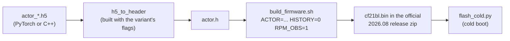
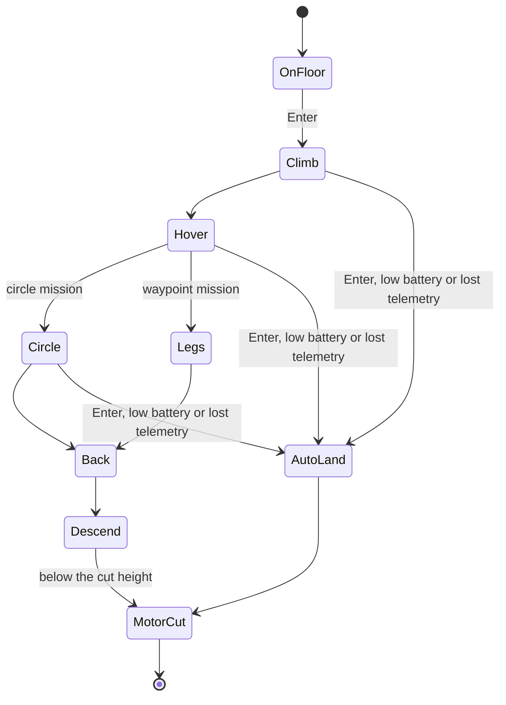

<!-- group: Flying | reviewed: 2026-11-26 -->
# Firmware and flights

How a trained checkpoint becomes firmware, how a learned flight is run and kept safe, how real
flights are measured, and what every flight day showed.

## From checkpoint to firmware

- [`l2f/py/export.py`](../l2f/py/export.py) writes PyTorch actors in RLtools' `.h5` layout, so
  every C++ tool works unchanged.
- `h5_to_header` turns the `.h5` into the firmware's C header. It must be built with the same
  flags as the checkpoint's variant.
- [`l2f/firmware/build_firmware.sh`](../l2f/firmware/build_firmware.sh) builds the learned
  controller on crazyflie-firmware 2026.08 for the Brushless (`cf21bl_defconfig`). `HISTORY` and
  `RPM_OBS` must match the variant (E: `HISTORY=0 RPM_OBS=1`). With `OFFICIAL_ZIP` it writes a
  flashable zip. [`patch_firmware.py`](../l2f/firmware/patch_firmware.py) ports the hooks onto
  the firmware; every edit must match exactly once.
- Flight candidates live in [`l2f/policies/`](../l2f/policies/README.md), one folder each:
  `actor.h5`, `actor.h`, `run.txt` (the recipe), test results.

> [!CAUTION]
> Flash with a **cold boot only** (`python3 flash_cold.py <zip>`), never a warm boot, then
> power-cycle. `flip.py` and `tricks.py` need the official firmware again afterwards.

## Firmware changes

What the paper's controller needed to fly this drone ([results.md](../l2f/docs/results.md#firmware-fixes-needed-on-top-of-the-papers-controller)):

| Change | Why |
| --- | --- |
| Build for `cf21bl`, not `cf2` | `cf2` images do not boot on the Brushless |
| Boot on PID; the learned controller runs only when selected | running it from boot crashed the radio task |
| Policy at 100 Hz (the simulator's step) | one pass takes about 0.7 ms; 500 Hz starved the radio task |
| Motor commands written every 1 kHz tick | the DShot driver re-arms its DMA in `motorsSetRatio()` and M1/M2 share a DMA request; writing only on policy ticks killed M1/M2 in flight |
| Handover from the measured motor speeds | the controller's state starts from the real rotor speeds, as training episodes start |
| A zero-thrust setpoint with every learned-controller packet | otherwise the commander's 2 s watchdog cuts the motors |
| Target-offset packets (12 bytes, later 24 with the target velocity) | the laptop moves the target; the policy only follows it |
| Measured rotor speeds as inputs (`motorsGetRPM` at 100 Hz) | variant E; the last valid value is kept on an invalid read; what the policy sees is logged as `rltr.r1-r4` |
| Position-error integral onboard, input clips `rlt.pdlp` (0.5 m) and `rlt.vdlp` (2 m/s) | the same inputs as in training |
| Optional range-sensor patch below 4 cm (`L2F_RANGE_MIN_PATCH`) | keep the Flow deck inside its specification (E4, off) |

## Flying with `rl_trigger.py`

[`rl_trigger.py`](../rl_trigger.py) runs on the laptop (Windows or macOS). It checks the drone,
selects the learned controller, sends the moving target, logs everything to
`logs/rl_trigger_flight_*.csv` and lands or cuts the motors when something goes wrong.

| Mode | What flies |
| --- | --- |
| `takeoff_and_switch` | stock PID takes off, the policy takes over after `--switch-after` s (**fly this first**) |
| `mission` | **no PID at all**: the policy takes off from the floor, climbs to `--height`, hovers, flies `--laps` circles (`--radius`, `--period`) or `--waypoints` legs (`--dwell` s each), comes back and lands at `--descent-rate`, cutting the motors near the floor |
| `land` | PID take-off, policy hover, then the policy's target descends and the motors cut below `--cut-height` |
| `hover_learned`, `figure_eight`, `hover_original` | older modes (policy take-off, PID baseline) |

**Controls and safety.**

- **Enter** starts, **Enter** again stops (`--hold`: fly only while Enter is held). A stop in the
  air in mission mode is an automatic landing; in other modes it cuts the motors.
- **Ctrl+C** cuts the motors at once. **Q** quits only on the floor.
- An emergency-stop watchdog cuts the motors within 1 s if the script dies or the radio drops; it
  stays latched until the drone is power-cycled.
- Automatic landing also starts on low battery under load (`--land-vbat`) or lost telemetry.
- Pre-flight checks: learned-controller firmware present, battery, estimator converged, yaw near 0
  (**the policy turns to yaw 0 of the Lighthouse frame: face the drone along +X**), and the
  supervisor's "can fly" bit (motor 3 intermittently fails the idle arming check and is named).
- On macOS the terminal needs the Input Monitoring permission; `--key-test 20` tests the keys
  without flying.
- `--slow-telemetry` sends about 40% fewer log packets; the log block is restarted automatically
  before any blind landing (both added after the 2026-11-25 telemetry drops). A blind landing
  descends straight down from the current target.

Before flying: `lighthouse_check.py` (deck, calibration, geometry, reception), `motor_check.py`
(idle speeds), `sensor_check.py` (decks and estimator, no flying).

## Measuring a flight

[`l2f/sim/flight_report.py`](../l2f/sim/flight_report.py) prints the simulator test's metrics from
a flight log, so real and simulated numbers compare directly:

| Metric | Definition |
| --- | --- |
| Tracking error | mean (and max) 3D distance to the target while the policy flies, per phase; "circle" is the sim test's number |
| Hover jitter | per motor, the standard deviation of the command $u = m / 65535$ over the hover phases, averaged over the 4 motors (the paper's smoothness metric) |
| Waypoint legs | arrival within 10 and 5 cm (time after the target moved), overshoot along the leg, final error (last 0.5 s), peak speed |
| Smoothness | tilt RMS and max, rotation-rate RMS, **wobble** (RMS distance from the 0.5 s moving average of the position), acceleration RMS |
| Landing | distance from the take-off point when the motors stopped |

Average tracking error alone misleads: on 2026-11-25 the sum policy was mid-table on error while
rocking far harder than any other. Report smoothness next to error.

## Flight history

### 2026-11-01 to 11-06: first flights

- **First learned hover** (paper noise and reward): the motors chattered between almost 0% and
  100% (gyro about 75 °/s against 3 °/s under PID). Fixed in training with the measured noise and
  an angular-acceleration cost.
- **First full mission with no PID** (policy I1, 2026-11-04, checkpoint 1.4M, `--ki 0`):

| Mission | Hover | Circle | Landing | Jitter |
| --- | --- | --- | --- | --- |
| 0.6 m, 0.3 m circle | 3.8-4.0 cm | 5.7-6.4 cm | 3.4-3.8 cm | 0.047-0.050 |
| 0.75 m, 0.6 m circle | 4.4 cm | 8.4 cm | 3.9 cm | 0.060 |
| 1.0 m, 0.6 m circle | 5.0 cm | 6.7 cm | 4.1 cm | 0.066 |
| 1.5 m, 0.6 m circle | 3.2 cm | 10.9 cm (one 36 cm Lighthouse jump) | 5.8 cm | 0.072 |

  For comparison on the same drone model (Busetto et al.): network 4.3 cm / 0.020, PID
  2.8 cm / 0.023, Mellinger 5.5 cm / 0.039 (hover).
- **Measured rotor speeds** (2026-11-06): C and E fly the circle as well as I1 (7.0-7.4 cm), E with
  25 inputs ([Policy I/O](05-policy-io.md#why-measured-rotor-speeds-replaced-the-action-history)).
  A sharp poke at 0.9 m (839 °/s within 20 ms) flipped C; training has no impulse disturbances.

### 2026-11-22: the sensor path

The sensor-path TD3 candidate held its position but shook (commands jumping 20-50% every 20 ms);
correlated gyro noise and estimate delays beyond the training range explained it
([Sensor path](08-sensor-path.md#findings)). Old-path reference policies (`oldpath_E`, `old3`)
were added as flight references.

### 2026-11-25: seven methods, 28 flights

One checkpoint per method from the 8-seed split-critic study, all picked by the same rule (no crash
in any of 1,300 simulated test episodes, hover jitter ≤ 0.12, then the best uneven-motor circle).
Missions matched the simulator's: 0.75 m height, 0.6 m circle in 10 s (0.38 m/s) and 6 s
(0.63 m/s), and waypoint jumps of 0.4 and 0.7 m. Record:
[flight_day_2026-11-25.md](../l2f/docs/flight_day_2026-11-25.md).

| Method | Circle P10 | Fast circle P6 | 0.7 m waypoint: settled error / oscillation | Hover | Tilt RMS | Wobble | Real jitter (sim) |
| --- | --- | --- | --- | --- | --- | --- | --- |
| OS-NMF-PGA | **7.2 cm** (2 flights) | 18.9 / 13.3 / 13.9 cm (3) | 14-16 cm / none | **1.3-3.0 cm** | **5-7°** | **1.4-1.5 cm** | 0.05-0.07 (0.066) |
| UPGrad | 7.6 cm | 15.5 cm | 11-15 cm / none | 2.9-4.4 cm | 6-9° | 1.3-1.8 cm | 0.08-0.14 (0.064) |
| SVD-PGA | 8.8 cm | **12.0 cm** | **8 cm** / ±5 cm | 3.6-7.1 cm | 11-14° | 2.3-3.2 cm | 0.19-0.24 (0.104) |
| DualProj | 9.0 cm | 14.9 cm | 7-14 cm / none | 8.0-9.6 cm | 7° | 1.4-1.7 cm | **0.05-0.06 (0.046)** |
| Variant E (TD3) | 10.6 cm | 21.1 cm | 17-26 cm / ±15 cm | 6.6-7.6 cm | 7-14° | 1.6-4.0 cm | 0.24-0.26 (0.101) |
| Sum | 11.6 cm | 16.7 cm | 13 cm / ±10-20 cm | 7.3-8.9 cm | **18-21°** | **4.7-5.2 cm** | 0.09-0.14 (0.059) |
| Aligned-MTL | **crashed** | – | – | 6.4 cm | rocked ±40° | – | 0.30 (0.111) |

What the day showed:

- Every aggregator except Aligned-MTL beat variant E on the circle and the fast circle; the gap grows
  with speed, as in simulation (circles at 0.94 m/s: MOO picks 10.1-12.1 cm against 14.7 cm).
- On the same split critic, plain summing gave the most violent policy and OS-NMF-PGA, UPGrad and
  DualProj flew smoothly: **the aggregator, not the critic, decides how smoothly the policy
  flies.**
- **Simulated jitter at selection predicts real smoothness.** The low-jitter picks kept it on the
  drone; the jerkier ones got worse, variant E and SVD-PGA about 2.5 times their simulated jitter.
  OS-NMF-PGA is the only policy whose real jitter matched the simulator's.
- Aligned-MTL rocked ±40° with motors slamming between 0 and full through the circle, then tilted,
  the Lighthouse dropped twice and it flipped.
- One flight per mission per method (OS-NMF-PGA three times on the fast circle: 18.9, 13.3,
  13.9 cm): real run-to-run spread is about ±2.5 cm, so close differences are not rankings.
- Telemetry stopped in 3 of 6 waypoint flights before the fixes (once after a corrupted log
  packet, `no LogEntry id=255`) while the radio link stayed up; after `--slow-telemetry` and the
  automatic log restart, no more drops.

## Flight candidates

| Folder | Training | Notes |
| --- | --- | --- |
| `2026-11-21_oldpath_E_s1_1600k` | old path, variant E, C++ | reference |
| `2026-11-22_ss_td3_s11_1800k` | sensor path, TD3 | flown 2026-11-22: shook |
| `2026-11-22_ss_dualproj3_s10_1800k` | sensor path, DualProj on 3 groups | not flown: crashes 84-92% at 20 ms delay in simulation |
| `2026-11-22_cal2_td3_s30_2000k` | sensor path, calibration 2 | survives delay and unseen layouts; jitter still high |
| `2026-11-22_old3_moosum3_s40_1800k` | old path, MOO sum on 3 groups | "old3", the reference of the reward studies |
| `2026-11-25_E_td3_s73_1900k` and six `2026-11-25_split_*` | old path, the 8-seed split-critic study | flown 2026-11-25 |

Details and test results: [`l2f/policies/README.md`](../l2f/policies/README.md).
