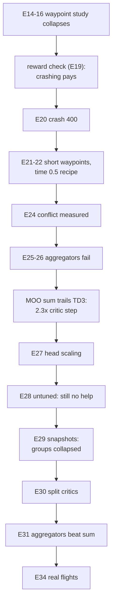

<!-- group: Results | reviewed: 2026-11-26 -->
# Experiment log

Every study of the project, in order: the question, what was run, what came out, and what it
changed. Numbers are medians over seeds and late checkpoints unless noted; the linked records
have every table and setting. In the viewer the table is sortable (click a column) and
filterable.

## All experiments at a glance

| ID | Date | Area | Question | Outcome | Verdict |
| --- | --- | --- | --- | --- | --- |
| E01 | 2026-11-01 | sim-to-real | Why does the first learned policy chatter? | Paper gyro noise 35× too low; measured noise + angular-acceleration cost halve the jumpiness | adopted |
| E02 | 2026-11-04 | task | Can one policy fly the whole mission with no PID? | Yes, with a curriculum and 0-12 ms delay randomization; I1 flew 4-8 cm | adopted |
| E03 | 2026-11-06 | inputs | Measured rotor speeds instead of action history? | E (25 inputs) flies like I1 (149) | adopted (E) |
| E04 | 2026-11-18 | MOO | Do aggregators help on 8 reward parts (C++, with bonus)? | None beats the sum; UPGrad 66% crashes; a total-value critic loss is needed | superseded |
| E05 | 2026-11-19 | MOO | Objectives per episode type (framing B)? | No conflict (cosines +0.87 to +0.99) | dropped |
| E06 | 2026-11-21 | reward | Survival bonus or crash penalty; zig-zag; landing cut; gyro clip | No bonus + penalty 200 best (0.8% crashed) | adopted |
| E07 | 2026-11-22 | reward | Does zig-zag make target steps faster? | No; the no-bonus penalty has the best steps | action rate kept |
| E08 | 2026-11-22 | trainer | Does the PyTorch TD3 match the C++ one? | Yes for E (p = 0.75); I1 has a tail | adopted (PyTorch) |
| E09 | 2026-11-22 | sensor path | How strong should the random force be? | Full force; the sensor path trains like the old path | adopted |
| E10 | 2026-11-22 | MOO | Sum or DualProj on the sensor path (8 seeds)? | No method better than TD3 | – |
| E11 | 2026-11-22 | MOO | Aggregators on the no-bonus reward (8 parts, 3 groups) | None beats the sum; DualProj on 3 groups ties | DualProj default (revised later) |
| E12 | 2026-11-22 | reward | Untuned weights (all 1) | Every run crashes: one step of angular acceleration costs more than a crash | – |
| E13 | 2026-11-22 | flight | First sensor-path flight; calibrations 1 and 2 | Shook: correlated gyro noise, delay beyond training | partly fixed |
| E14 | 2026-11-23 | waypoints | Time-to-target runs 1-6 | Every run collapsed or crashed 72-100% at waypoints | failed |
| E15 | 2026-11-23 | MOO | Conflict with ungrouped objectives | Crash term against the dense costs | – |
| E16 | 2026-11-23 | waypoints | Objective study (13 arms) | No gain; a leg costs more than a crash | failed → diagnosed |
| E17 | 2026-11-23 | check | Does the Mac build reproduce old3? | Yes, deterministic | ✓ |
| E18 | 2026-11-23 | sim-to-real | Study 1: drag, lag range, gain wander | No precision cost, slightly more robust | adopted |
| E19 | 2026-11-23 | reward | Reward check of the base recipe | Crashing pays in 8.6-22.4% of free-flight states | finding |
| E20 | 2026-11-23 | reward | Study 2: progress reward, crash 400 | Crash 400 new base; progress failed (10-20 cm offset) | crash 400 adopted |
| E21 | 2026-11-23 | waypoints | Study 3: waypoints without a time cost | Short jumps only; waypoint training does not help | – |
| E22 | 2026-11-23 | waypoints | Study 4: time cost 0.2 / 0.5 (8 seeds) | 0.5 best waypoint arm; 0.2 worse than none | time 0.5 adopted |
| E23 | 2026-11-23 | waypoints | Why do policies stop 9 cm off? | Slow settling, not an offset | finding |
| E24 | 2026-11-23 | MOO | Gradient conflict on the time 0.5 recipe (shared critic) | Early: safety against the rest; late: precision orthogonal | revised by E30 |
| E25 | 2026-11-23 | MOO | Study 5: six aggregators (shared critic) | No MOO arm beats TD3; UPGrad 50.6% crashes | – |
| E26 | 2026-11-23 | MOO | Study 6: DualProj on 8 seeds, critic loss, delayed start | DualProj's lead was noise; late UPGrad does not collapse | – |
| E27 | 2026-11-23 | MOO | Study 7: head scaling | Sum level with TD3, but groups collapse (found in E29) | superseded |
| E28 | 2026-11-23 | MOO | Study 8: untuned reward (equal shares) | Tuning worth a lot; aggregators no help (collapsed critic) | to repeat |
| E29 | 2026-11-24 | MOO | What did the critic learn? (snapshots) | Head-scaled groups are copies; split critics distinct | finding |
| E30 | 2026-11-24 | MOO | Study 9: separate critics per group | Real conflict appears (57-82% of updates) | adopted (`--split-critic`) |
| E31 | 2026-11-25 | MOO | Study 10: aggregators on split critics (8 seeds) | Reweighting aggregators beat the sum; SVD-PGA matches TD3 | main result |
| E32 | 2026-11-25 | statistics | Which differences survive a correction? | Only smoother commands | finding |
| E33 | 2026-11-25 | MOO | Faster circles in simulation | MOO picks beat TD3 at speed; SVD-PGA crashes at 1.26 m/s | finding |
| E34 | 2026-11-25 | flight | Seven methods, 28 real flights | Aggregators (but Aligned-MTL) beat TD3 on the circle | finding |

## Early November: making it fly

**E01 Motor chatter.** The first flown policy (paper noise and reward) chattered between about 0%
and 100% command, gyro about 75 °/s against 3 °/s under PID. The paper's gyro noise (0.002 rad/s)
is about 35 times below this drone's (0.069 rad/s); with the measured noise the simulator
reproduces the chatter. Retraining with it plus an angular-acceleration cost of 2e-4 halves the
command jumpiness; 1e-3 is too strong (the policy stops recovering from tilts).
→ [results.md](../l2f/docs/results.md#motor-chatter)

**E02 Mission training.** Floor contact, take-off, landing, circle and line episodes with a moving
target, ramped in by a curriculum (without it training never learns to fly), 0-12 ms of estimate
delay (the first policies collapsed above about 5 ms), mild domain randomization (scale 0.3; full
ranges prevent learning), ground effect, Lighthouse-like jumps and the position-error integral.
Policy I1 flew the full mission at 4-8 cm. → [results.md](../l2f/docs/results.md#mission),
[Flights](11-flight.md#2026-11-01-to-11-06-first-flights)

**E03 Measured rotor speeds.** Variants A-E with per-motor mismatch: speeds plus 4 history steps
(C) or speeds alone (E, 25 inputs) match the 149-input I1 in simulation and in flight.
→ [Policy I/O](05-policy-io.md#why-measured-rotor-speeds-replaced-the-action-history)

## Mid November: first MOO, plan step 1, PyTorch, sensor path

**E04 C++ multi-objective critic.** 8 reward parts with the survival bonus, aggregators on the 8×8
Gram matrix (checked against TorchJD to 1e-12). None beat the sum: UPGrad 348 cm / 66% crashes (it
raised the action-rate weight 7-18×), SVD-PGA 27%. Fitting each part alone learned far slower;
adding the total's TD error to the loss (`MOO_TOTAL`) fixed it (4.3 cm, 0.7%).
→ [results.md](../l2f/docs/results.md#multi-objective-critic-c-removed-2026-11-22)

**E05 Task objectives.** One objective per episode type (and per hidden dynamics regime): pairwise
cosines +0.87 to +0.99 after 800k steps, never negative, so a task split looks like a random
split. Real conflict appeared only between reward parts.
→ [results.md](../l2f/docs/results.md#task-objectives-and-conflict-diagnostics-c)

**E06 Plan step 1.** Every option off by default and bit-identical when off. Survival bonus against
crash penalty, zig-zag against action rate, landing cut, gyro clip and rotation crash
(3 seeds each): no bonus with penalty 200 is clearly best.
→ [Reward](06-reward.md#crash-penalty-against-survival-bonus)

**E07 Target steps.** Point-to-point episodes (0.2-0.45 m jumps): zig-zag does not make steps faster
and fails to respond more often; the no-bonus penalty has no crash and the least overshoot.
→ [results.md](../l2f/docs/results.md#simulator-and-reward-options-plan-step-1)

**E08 PyTorch against C++.** Single updates agree after an Adam $\epsilon$ fix; whole runs agree
statistically for E (6 seeds each). → [TD3](07-td3.md#pytorch-against-c)

**E09 Random-force strength on the sensor path.** Full force: 5.8 cm, 8.1 cm uneven, no crash in
810 test episodes; weaker forces are no better and each had a collapsed seed.
→ [results.md](../l2f/docs/results.md#training-on-the-sensor-path-and-the-random-force-strength-plan-q16-2026-11-22)

**E10 MOO on the sensor path.** TD3, sum and DualProj on 3 groups, 8 seeds: no method better on
circle or crashes; about one run in ten collapses in any method.
→ [results.md](../l2f/docs/results.md#moo-on-the-sensor-path-2026-11-22-lab-computer-8-seeds)

**E11 PyTorch MOO, no bonus.** Rounds 1-3 (8 parts and 3 groups; sum, Aligned-MTL, UPGrad, DualProj,
PCGrad, OS-NMF-PGA, SVD-PGA): none beats the sum. PCGrad and UPGrad on 8 parts amplify the small
smoothing gradient that opposes the crash term (projecting a norm-1.0 gradient off a norm-0.10 one
at cosine −0.95 adds about 9.5 smoothing gradients); on 3 groups smoothing is merged with larger
terms and UPGrad stays near the sum. SVD-PGA whitens the gradients and gives the crash group, the
largest, the smallest weight: one seed never learned to fly.
→ [results.md](../l2f/docs/results.md#pytorch-moo-on-the-no-bonus-reward-2026-11-22)

**E12 Untuned weights.** Every weight 1: every run crashes. The angular-acceleration term alone costs
about −1,819 per step for a flying policy, so crashing is optimal, and the saturated networks pass
no gradient after about 0.4M steps. Half of what tuned weights do is unit conversion.
→ [Reward](06-reward.md#every-cost-term)

**E13 First sensor-path flight and calibration.** The TD3 candidate held position but shook
(15-25 Hz). Correlated gyro noise and delays beyond training explained it; calibrations 1 and 2
followed. → [Sensor path](08-sensor-path.md#findings)

## 2026-11-23: the time-to-target study (lab computer)

**E14 Runs 1-6.** Waypoints, four reward terms, five simulator options and seven aggregators at
once, 3M steps: run 1 collapsed (power cost paid for idling), runs 2-3 collapsed (dead time), run 4
crashed least with a flat position cap but stopped 30 cm short, run 5 (no cap) was worse, run 6
(Huber cap) crashed 72-95% at waypoints.
→ [Waypoints](10-waypoints.md#the-first-study-everything-collapsed),
[record](../l2f/docs/time_to_target_study.md#4-training-rounds-and-observations)

**E15 Conflict, ungrouped.** 11 objectives: the crash term opposes action rate (cosine −0.66, 92%
of updates), time, power and angular acceleration; grouping into 4 had hidden it.
→ [record](../l2f/docs/time_to_target_study.md#conflict-study-compare_conflict-are-the-objectives-in-conflict)

**E16 Objective study.** 13 arms (ungrouped, regrouped, energy per leg, firmware input clips, jump
ramp): no gain; every waypoint-trained arm crashed more at waypoints (65-100%) than old3 (56%),
never trained on them. Root cause: surviving a leg cost about −430, the crash −200.
→ [Waypoints](10-waypoints.md#root-cause-a-leg-cost-more-than-a-crash)

## 2026-11-23 to 25: one change at a time (Mac, 8 seeds)

**E17 Reproduction.** The Mac build reproduces old3 exactly (crash 0, jitter 0.0489).
→ [record](../l2f/docs/reward_studies.md#2-check-the-mac-build-reproduces-old3)

**E18 Study 1, simulator options.** Drag, lag range and gain wander: no measurable precision cost
(circle 4.0 against 3.5 cm, within the 3.2-5.4 cm seed spread), slightly more robust. Kept.
→ [record](../l2f/docs/reward_studies.md#3-study-1-sim-to-real-options)

**E19 Reward check of the base recipe.** Crashing pays in 8.6% (old3) to 22.4% of free-flight states;
base seed 71 learned to crash (return improved while episodes shrank to 0.2-0.3 s).
→ [Reward](06-reward.md#the-crash-incentive)

**E20 Study 2.** Crash 400 doubles the crash-free checkpoints (22/36 against 11/36) for about 1.2 cm
of circle precision: new base. The progress reward passed the check and failed in training.
→ [Reward](06-reward.md#fixes-that-were-tried)

**E21 Study 3.** A gate first: only 0.3-0.5 m jumps pass with crash 400. Mission-only policies already
fly 0.8 m jumps without crashing; waypoint training made them slightly faster, no more accurate,
and cost mission precision. → [record](../l2f/docs/reward_studies.md#6-study-3-waypoints-without-a-time-cost)

**E22 Study 4, time cost.** Time 0.5 is the best waypoint arm (circle 6.0 cm, 1.4% crashes, 79.5%
within 10 cm); 0.2 is worse than none; mission-only policies are about as good at short jumps.
→ [Waypoints](10-waypoints.md#the-time-cost)

**E23 Settling.** The "9 cm offset" is slow settling: with 6 s legs, 58-97% get within 5 cm.
→ [Waypoints](10-waypoints.md#why-every-policy-stops-about-9-cm-off)

**E24 Conflict, time 0.5 recipe.** Shared unscaled critic: early, safety (norm about 10× the others)
against the rest; late, precision roughly orthogonal to the other three. Later shown to be partly
the critic's doing. → [record](../l2f/docs/reward_studies.md#9-gradient-conflict-on-the-time-05-recipe)

**E25 Study 5, aggregators.** TD3 4.9 cm / 0.8%; sum 7.4 cm / 2.5%; DualProj 5.7 cm; UPGrad 18.4 cm /
50.6%; the balancing ones 13-14% crashes with negative weights on precision and safety.
→ [MOO](09-moo.md#why-the-aggregators-did-not-help-on-the-shared-critic)

**E26 Study 6.** Over 8 seeds DualProj is no better than sum (6.6% crashes). The per-group critic loss
is not why sum trails TD3. UPGrad started at 1.2M does not collapse (2.5%) but adds nothing.
→ [record](../l2f/docs/reward_studies.md#11-study-6-dualproj-on-8-seeds-the-critic-loss-delayed-aggregators)

**E27 Study 7, head scaling.** The 4-head critic's total moved 2.3× as far per update; head scaling
fixed that and MOO sum became level with TD3 (5.0 cm, 32/72 crash-free checkpoints), but E29
showed the groups had collapsed. → [MOO](09-moo.md#critic-designs)

**E28 Study 8, untuned.** Equal group shares, crash 600: untuned TD3 10.1 cm / 6.0% against tuned
4.9 cm / 0.8%; no aggregator helped, and the PGA weights swung ±100-270. Run on the collapsed
critic, so it must be repeated. → [record](../l2f/docs/reward_studies.md#13-study-8-untuned-reward)

**E29 Critic snapshots.** `critic_snapshot.py` at 200k and 1.2M steps: head-scaled group values
correlate 0.99-1.00 (copies); split critics +0.29 to +0.68 with fits $R^2$ 0.98-1.00.
→ [MOO](09-moo.md#shared-and-head-scaled-the-groups-collapse)

**E30 Study 9, split critics.** Separate networks per group with `--total 1`: circle 4.9 cm,
smoothest commands (jitter 0.065); opposed updates 57-82% in four of six pairs.
→ [record](../l2f/docs/reward_studies.md#14-study-9-separate-critics-per-group)

**E31 Study 10, aggregators on split critics.** 8 seeds: crashes 1.7-2.7% for every reweighting
aggregator against 4.5% for the sum; SVD-PGA 4.9 cm and 83.5 / 76% waypoints against TD3's 6.0 cm
and 79.5 / 69%. → [MOO](09-moo.md#on-split-critics-the-aggregators-beat-the-sum)

**E32 Statistics.** Per seed, Mann-Whitney with Holm over 48 comparisons: only the jitter gain of
sum, DualProj, UPGrad and Aligned-MTL holds. → [Issues](13-issues.md#evidence-and-statistics)

**E33 Faster circles in simulation.** At 0.94 m/s every MOO pick tracks better than TD3 (10.1-12.1
against 14.7 cm); at 1.26 m/s SVD-PGA crashed 28 times in 100.
→ [record](../l2f/docs/flight_day_2026-11-25.md#faster-circles-in-simulation-before-flying-them)

**E34 Flight day.** 28 flights of seven methods; see
[Flights](11-flight.md#2026-11-25-seven-methods-28-flights).

## How the studies led to each other

## Adding an experiment

Add a row to the table with the next ID, a short entry under its period, and update
[Issues](13-issues.md) and the status in the [Overview](01-overview.md) if it changes them; the
full record goes in `l2f/docs/`. Template in [Conventions](CONVENTIONS.md#adding-an-experiment).
